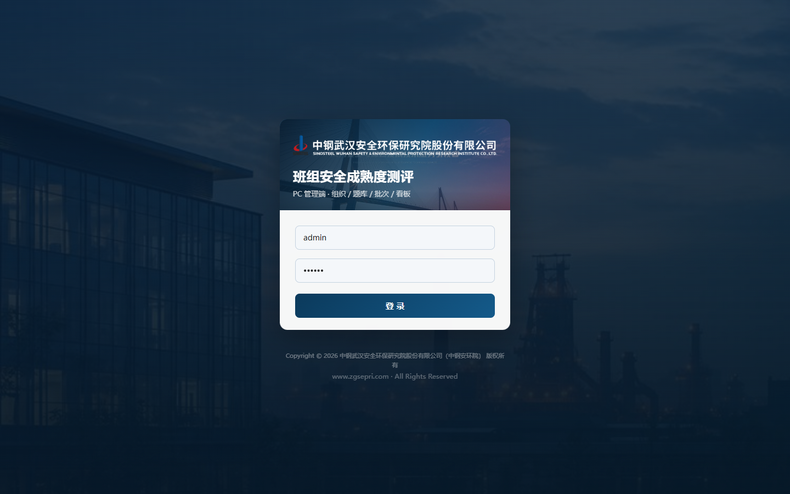
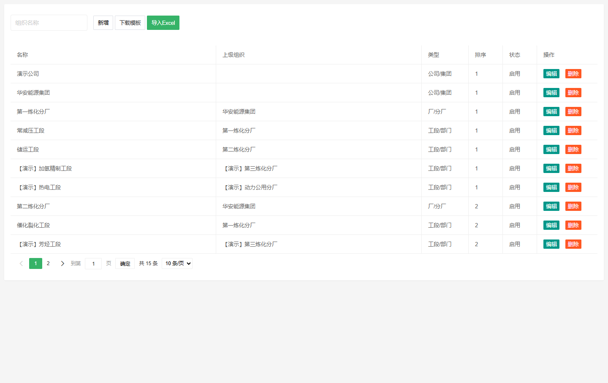
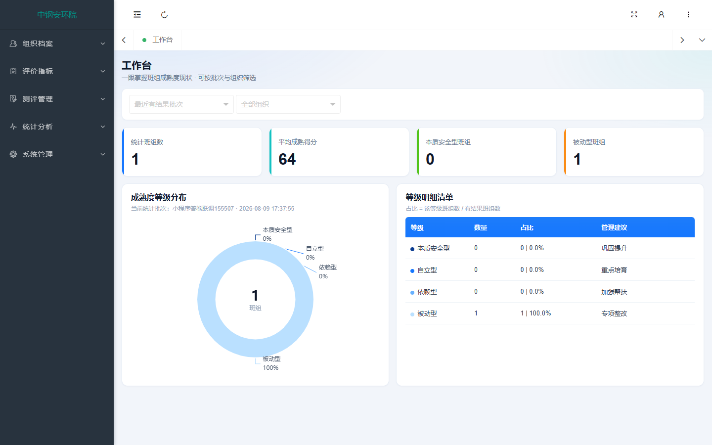
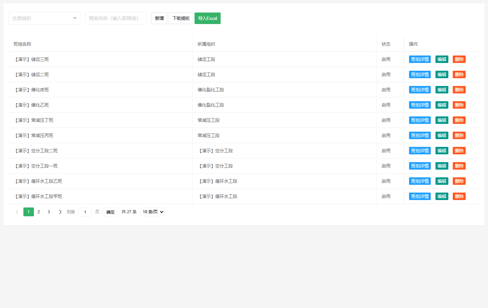
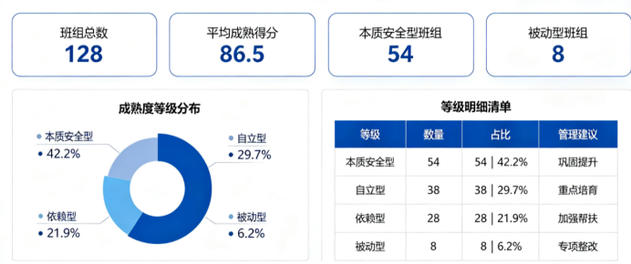
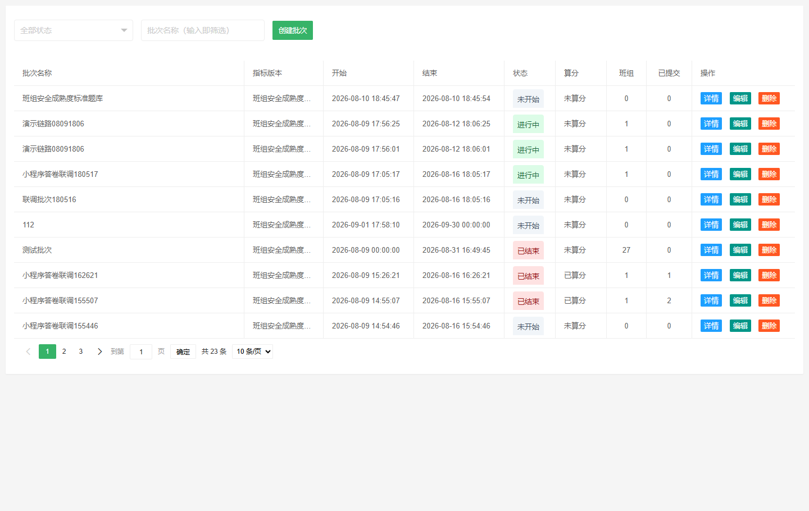
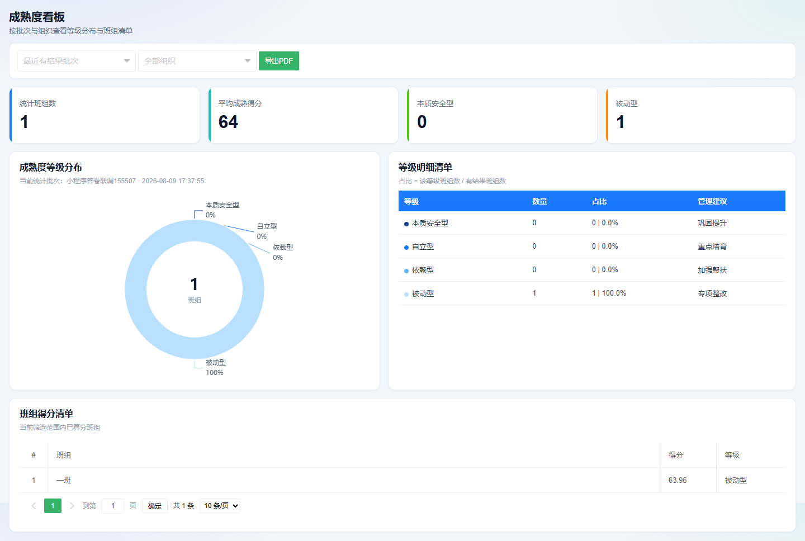
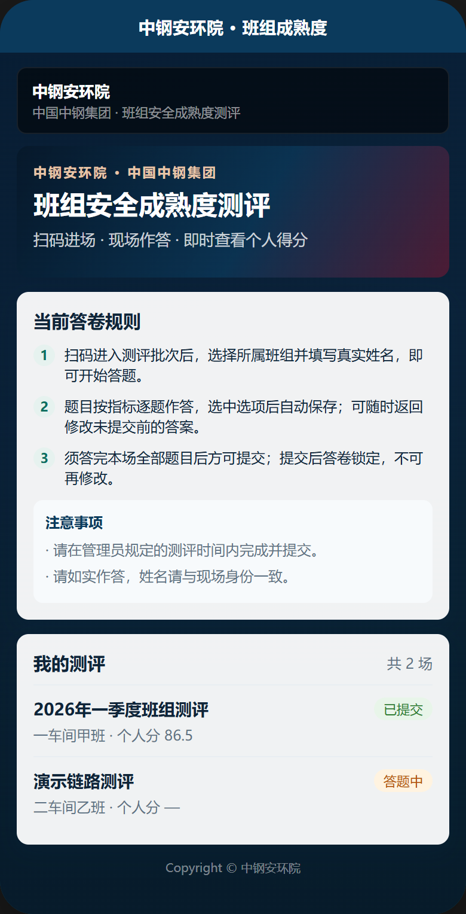
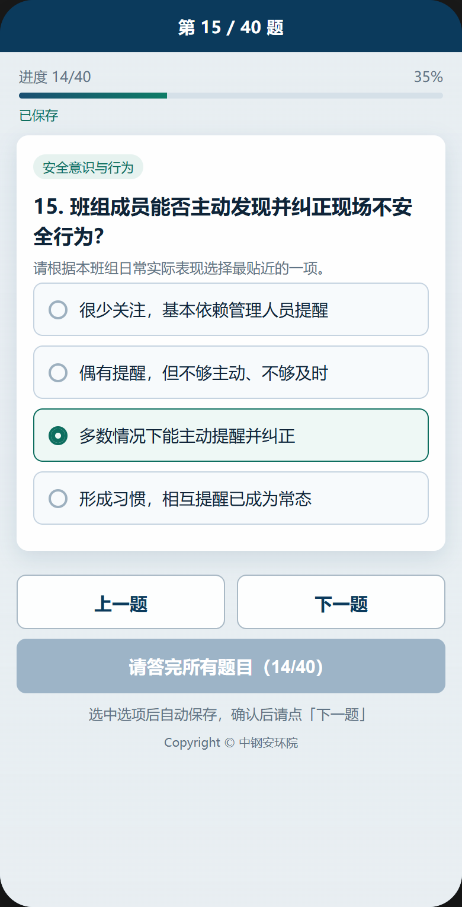
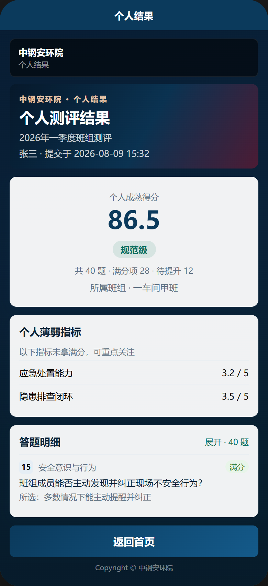

# 班组安全成熟度测评系统

面向企业班组安全管理的测评与改进平台。系统以 **PC 管理端 + 微信小程序** 为双端入口，覆盖组织建模、题库配置、测评批次、自动算分、成熟度看板和现场答题闭环。

> 项目状态：可本地启动、可联调演示。默认分支为 `feat/context-compression`。

## 项目一览

| PC 管理端 | 微信小程序 |
| --- | --- |
| 组织 / 班组 / 成员管理 | 扫码进入测评 |
| 题库与指标配置 | 班组信息确认 |
| 批次发布与生命周期 | 在线答题与提交 |
| 自动算分与等级判定 | 测评结果查看 |
| 全国 / 企业 / 班组看板 | 结果同步回管理端 |

## 界面预览

### PC 管理端

看板集中呈现班组总数、平均成熟度得分、等级分布和管理建议，便于从总体趋势快速定位需要改进的班组。

| 登录与工作台 | 组织与班组管理 |
| --- | --- |
|  |  |
|  |  |

### 测评与数据看板

| 成熟度工作台 | 测评批次 |
| --- | --- |
|  |  |
|  |  |

### 微信小程序

| 测评入口 | 在线答题 | 测评结果 |
| --- | --- | --- |
|  |  |  |

## 核心流程

```text
组织建模 → 题库与指标配置 → 创建测评批次 → 小程序扫码答题
    ↑                                              ↓
    └──────────── 看板分析 / 报告导出 / 改进跟踪 ←──┘
```

## 技术组成

- **PC 管理端**：ThinkPHP 5 + PHP 7.3，提供组织、题库、批次、权限、看板和报告能力
- **小程序端**：原生微信小程序，负责扫码进场、答题、提交和结果展示
- **数据层**：MySQL，建库与增量脚本集中在 `sql/`
- **接口层**：PC 管理 API 与小程序 API 均位于 `backend/application/`

## 目录结构

| 路径 | 说明 |
|------|------|
| `backend/` | ThinkPHP 5 PC 后台 + 小程序 API |
| `miniprogram/` | 微信小程序（进场 / 答题 / 结果） |
| `sql/` | 建库与增量脚本 |
| `docs/` | 需求、API、启动与交接文档 |
| `scripts/` | 启动、样例导入、联调脚本 |

## 快速启动

完整步骤（PC + 小程序 + 真机 + 排错）见：

**→ [`docs/启动说明.md`](docs/启动说明.md)**

```powershell
# 1. 启动后端（推荐：PC 和小程序都能用）
cd d:\phpstudy_pro\WWW\team-maturity
powershell -ExecutionPolicy Bypass -File scripts\start-mini-api.ps1

# 浏览器打开 PC：http://127.0.0.1:8088/  账号 admin / 123456
# 微信开发者工具导入：miniprogram/
# 编译模式：pages/exam/index   参数 batch_id=进行中批次ID
```

| 项 | 值 |
|----|-----|
| PC 地址 | http://127.0.0.1:8088/ |
| 数据库 | `team_maturity` @ `127.0.0.1` / `root` / `123456` |
| 演示管理员 | `admin` / `123456` |
| 小程序目录 | `miniprogram/` |
| 小程序说明 | [`miniprogram/README.md`](miniprogram/README.md) |

## 常用脚本

```powershell
# 仅本机 127.0.0.1（旧方式，真机连不上）
powershell -ExecutionPolicy Bypass -File scripts\start-dev.ps1

# 全网卡 0.0.0.0（小程序真机 / 开发者工具推荐）
powershell -ExecutionPolicy Bypass -File scripts\start-mini-api.ps1

# 小程序答卷 API 联调（不依赖微信）
php scripts\test-mini-paper.php
```

## 更多文档

- 启动：[`docs/启动说明.md`](docs/启动说明.md)
- 交接进度：[`docs/交接说明-开发进度与待办.md`](docs/交接说明-开发进度与待办.md)
- 小程序 API：[`docs/03-mini-api.md`](docs/03-mini-api.md)
- 文档索引：[`docs/README.md`](docs/README.md)
