# 班组安全成熟度测评系统  


> PC端：班组安全成熟度测评系统
> 配套端：微信小程序（员工扫码答题）

## 目录

1. [系统简介与登录](#1-系统简介与登录)  
2. [界面总览与工作台](#2-界面总览与工作台)  
3. [组织档案](#3-组织档案)  
4. [评价指标与题库](#4-评价指标与题库)  
5. [测评批次（核心流程）](#5-测评批次核心流程)  
6. [结果查询](#6-结果查询)  
7. [统计分析](#7-统计分析)  
8. [系统管理](#8-系统管理)  
9. [常见问题](#9-常见问题)  

---

## 1. 系统简介与登录

### 1.1 系统做什么

本系统用来组织一次完整的「班组安全成熟度」测评，大致分三段：

1. **PC 后台**：维护组织与班组、指标题库、创建测评批次，开测后导出小程序码；  
2. **微信小程序**：员工扫码进场，选择班组、填写姓名后答题、交卷；  
3. **PC 后台（看结果）**：查看个人/班组成绩、等级与薄弱项，并用看板、趋势、排行做汇总分析。

说明：PC 端主要负责发测评和看结果；现场大量答题都在小程序完成。人员不必事先全部导入，答题时在小程序里选班组、填姓名即可入库。

### 1.2 如何登录

1. 用 Chrome 或 Edge 打开系统地址。  
   - 当前测试环境示例：`http://47.114.75.252/Login`  
   - 正式上线后一般改为单位域名（以部署通知为准）。  
2. 输入账号、密码，点击 **登录**。  
3. 登录成功后进入左侧菜单 + 右侧内容区的管理界面。

测试环境常用账号（以现场实际发放为准）：

| 项 | 值 |
|----|-----|
| 账号 | `admin` |
| 密码 | `123456`（上线后请尽快修改） |


**注意：**

- 建议使用较新版本的 Chrome / Edge；若页面样式错乱，可先强制刷新（Ctrl + F5）。  
- 连续输错密码可能被短暂锁定，稍后再试，或联系系统管理员处理。  
- 离开座位前请点击右上角账号菜单中的 **注销登录**。

---

## 2. 界面总览与工作台

登录后，左侧是功能菜单，右侧是当前功能页面。顶部一般有刷新、全屏等常用按钮。

主要菜单如下：

| 一级菜单 | 常用功能 | 什么时候用 |
|----------|----------|------------|
| 组织档案 | 组织架构、班组、成员 | 建档、查人、补录 |
| 评价指标 | 指标版本、题库、等级与赋能 | 改标准、改题目、配等级区间 |
| 测评管理 | 测评批次、结果查询、模拟做题 | 发测评、看答卷 |
| 统计分析 | 成熟度看板、成长趋势、班组排行 | 汇报、对比、导出 |
| 系统管理 | 管理员、角色、导入任务、操作日志 | 账号与权限 |

多数列表页支持 **输入即筛选 / 下拉即刷新**，一般不必再点「查询」按钮。

### 2.1 工作台（首页）

工作台用来一眼看最近一次（或所选）测评批次的整体情况，包括：

- 统计班组数  
- 平均成熟得分  
- 本质安全型班组数、被动型班组数  
- 成熟度等级分布图  
- 各等级数量、占比及对应管理建议  

可按 **批次**、**组织** 下拉筛选；换选项后页面会自动刷新数据。尚无算分结果时，部分指标可能显示为 0 或空。

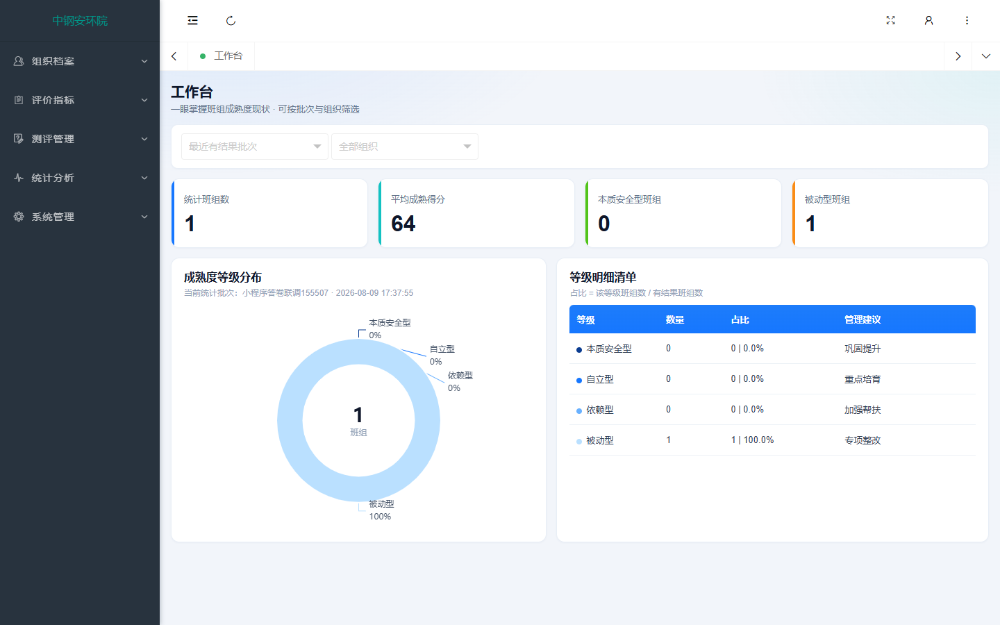

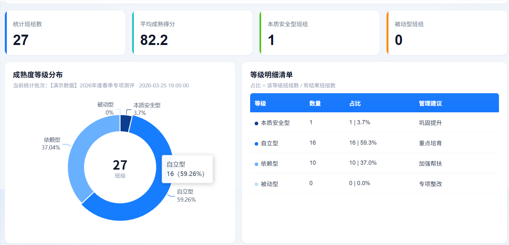

---

## 3. 组织档案

开测前至少要准备好 **组织树** 和 **班组**。成员可以后补，也可以完全依赖小程序现场登记。

### 3.1 组织架构

路径：**组织档案 → 组织架构**

用来维护公司、厂区、车间、工段等层级（层级数不强制固定）。常见操作：

- 新增下级组织  
- 修改名称  
- 调整启用/停用状态  
- 需要时可用模板做批量导入（见系统中的导入入口）

组织树会在「绑班组」「按组织筛结果/看板」时用到，名称建议与现场习惯一致，避免后期对不上。

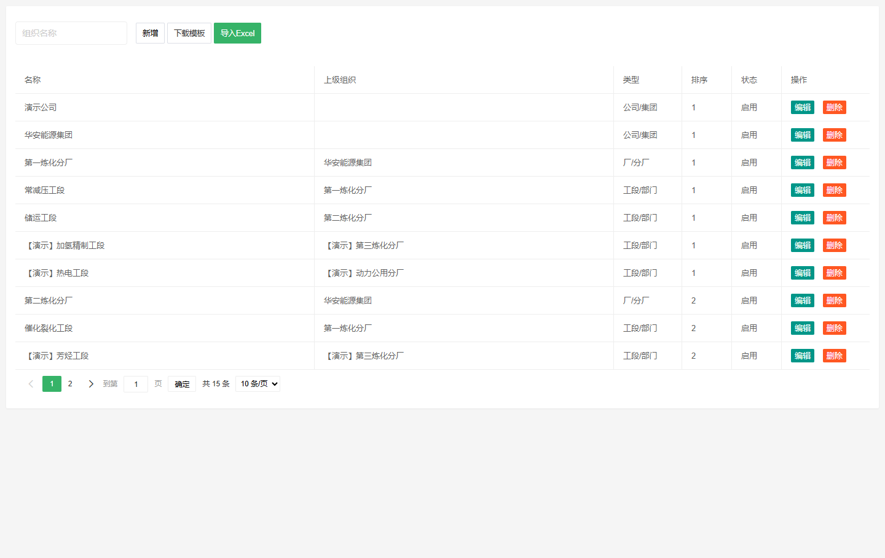

### 3.2 班组管理

路径：**组织档案 → 班组管理**

班组必须挂在某个组织节点下。创建测评批次时，就是从这些班组里勾选参评对象。

常见操作：

- 新增 / 编辑班组（名称、所属组织、状态）  
- 按组织、关键字筛选  
- 停用班组：一般不再加入新批次；已在进行中批次里的，仍可继续答完（以系统实际提示为准）

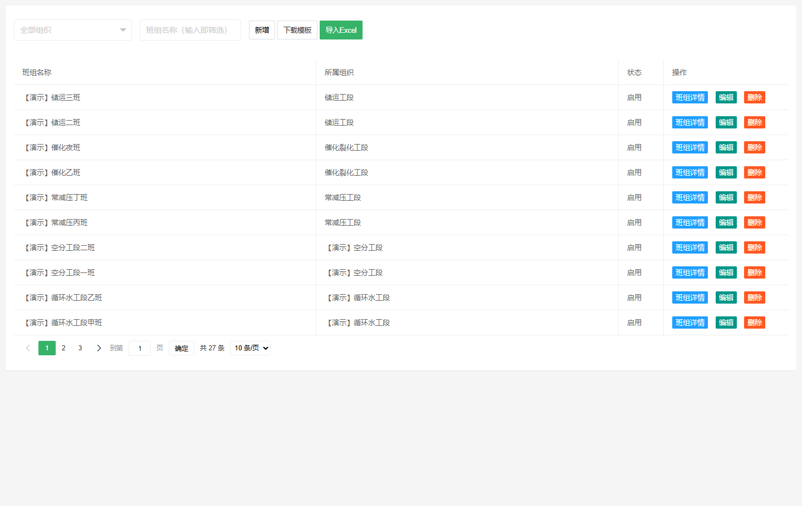

### 3.3 成员管理

路径：**组织档案 → 成员管理**

用于查看、补录、修正成员信息（姓名、所属班组、角色、手机号等）。手机号非必填。

筛选说明：

- 可按班组、角色、姓名/手机筛选；  
- 「全部角色 / 全部班组」表示不限制条件。  

正式测评时，员工多在小程序自助填姓名；本页更适合事后核对、补录和管理员查询。

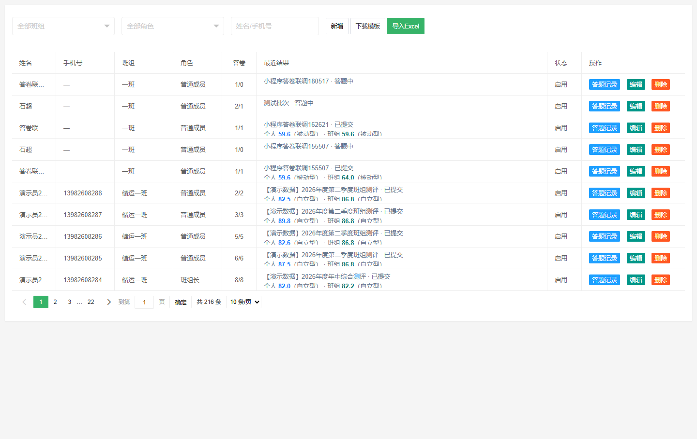

### 3.4 班组答题详情

路径：**班组管理 → 班组详情**（或结果相关入口中的班组详情）

可查看某班组在指定批次下的得分、等级及答题汇总情况。页面上可用 **测评批次** 筛选。

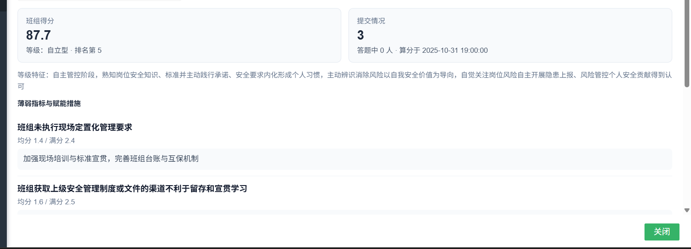

### 3.5 个人答题详情

路径：**成员管理 → 答题记录**

1. 在成员列表中找到对应人员，打开 **答题记录**；  
2. 可看到该成员参加过的批次列表；  
3. 点击 **查看结果**，进入某一批次的个人答卷明细（题目、选项、得分等，按该批次开测时的试卷快照展示）。

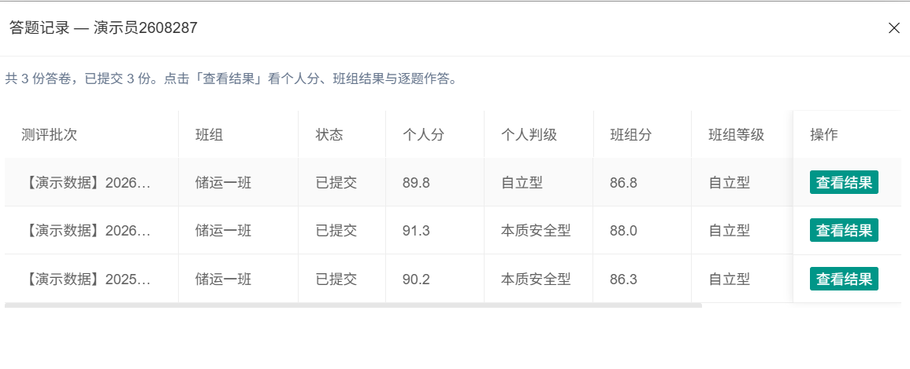


---

## 4. 评价指标与题库

测评用的「考什么、怎么算、怎么定级」，都在本模块维护。

### 4.1 指标版本

路径：**评价指标 → 指标版本**

一套指标体系对应一个 **版本**，状态包括：

| 状态 | 含义 | 能否改题库 | 能否用于新建批次 |
|------|------|------------|------------------|
| 草稿 | 编辑中 | 可以 | 不可以 |
| 已发布 | 正式可用 | 一般不可再改 | 可以 |
| 停用 | 历史版本 | 不可维护 | 不可以 |

要点：

- 只有 **草稿** 才显示「维护题库」一类入口；  
- 创建测评批次时，只能选 **已发布** 版本；  
- 需要改题时：在已有版本上 **复制出新草稿** → 改完再发布，不要直接改正在用的已发布版本。

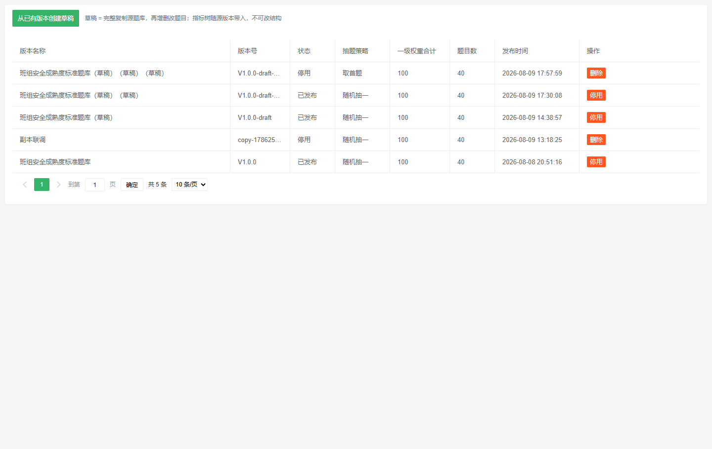

### 4.2 指标与题库

路径：**评价指标 → 指标与题库**

在某个版本下维护：

- 一级 / 二级 / 三级指标（含权重）  
- 挂在三级指标下的题目与选项  

开测时，系统会按规则从题库抽题，并写入本次批次的 **试卷快照**。之后员工答题和算分都认这份快照，即使后来改了题库，也不影响已经开测的批次。

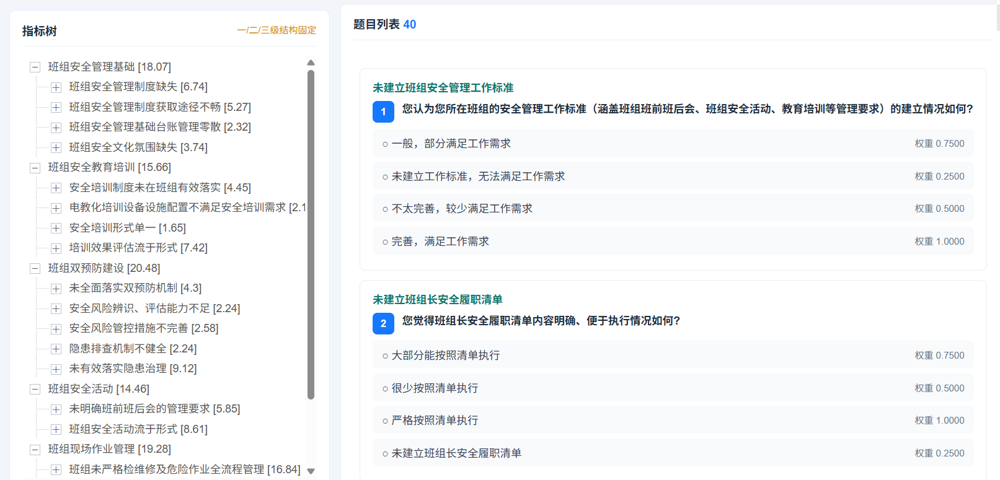

**如何安全地改题目：**

1. 在「指标版本」中，基于现有版本新建一份 **草稿**（复制）；  
2. 进入草稿的题库维护页，修改或新增三级指标下的题目/选项；  
3. 当前业务上，一二三级指标结构一般保持固定，日常主要改三级下的题目；  
4. 校验通过后发布新版本；  
5. 下次创建批次时，选择这份新发布的版本即可。

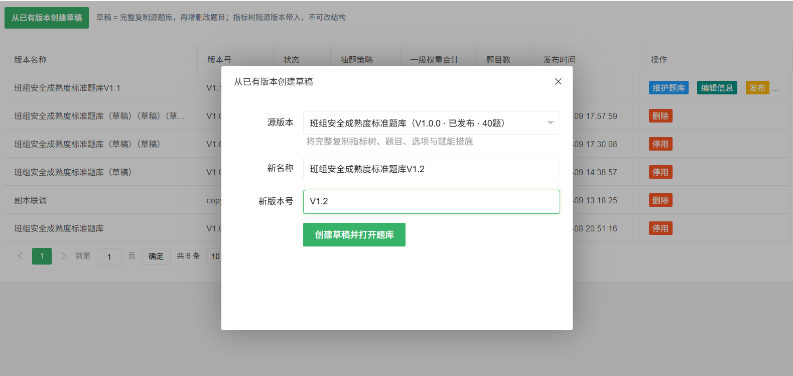

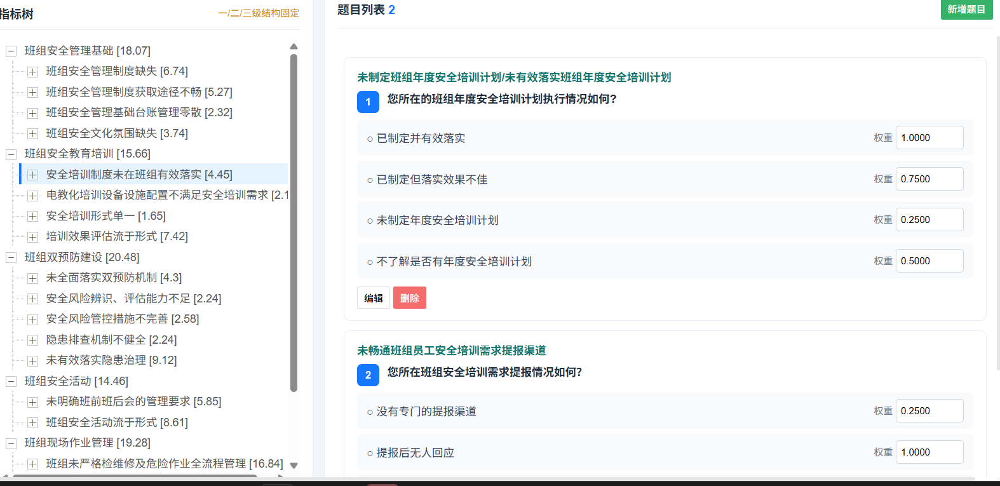

### 4.3 等级与赋能

路径：**评价指标 → 等级与赋能**

两块内容：

1. **等级区间**：如被动型、依赖型、自立型、本质安全型的分数上下限及阶段说明；  
2. **赋能措施**：薄弱指标对应的建设/改进建议文案。  

班组算分判级、结果页建议展示，都会引用这里的配置。改完后，对后续重新算分或新批次生效（已出结果的历史展示以当时落库数据为准）。


### 4.4 模拟做题（可选）

路径：**测评管理 → 模拟做题**

不必创建正式批次，即可按某指标版本抽题作答、看得分与等级建议。适合培训演示或核对口径，**不会写入正式测评台账**。

---

## 5. 测评批次（核心流程）

路径：**测评管理 → 测评批次**

这是发测评的主入口。一条批次从创建到出结果，通常按下面顺序走完。

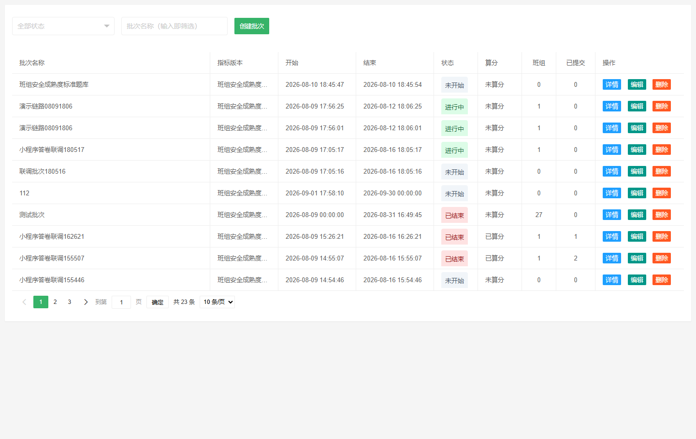

列表常见字段：

| 列 | 含义 |
|----|------|
| 状态 | 未开始 / 进行中 / 已结束 |
| 算分 | 未算分 / 已算分 等 |
| 班组 | 已绑定的参评班组数 |
| 已提交 | 已交卷人数 |
| 名称 | 支持输入关键字即时筛选 |

### 5.1 推荐操作顺序

```text
① 确认已有「已发布」的指标版本（题库齐）
② 创建批次（名称、版本、起止时间）
③ 在详情里勾选参评班组并保存
④ 点击「开测」（抽题并生成试卷快照；开测后版本与班组锁定）
⑤ 导出小程序码，发给参评班组
⑥ 员工微信扫码 → 选班组 → 填姓名 → 答题交卷
⑦ 到期后「结束并自动算分」（必要时可再「重新算分」）
⑧ 到「结果查询 / 统计分析」查看与导出
```

### 5.2 创建批次

1. 点击 **创建批次**。  
2. 填写：  
   - 批次名称（建议带时间或轮次，如「2026年一季度××厂测评」）  
   - 指标版本（仅已发布可选）  
   - 开始时间、结束时间（测评窗口）  
3. 保存后，系统一般会直接进入「选班组 / 开测」详情，无需再回列表点一次详情。

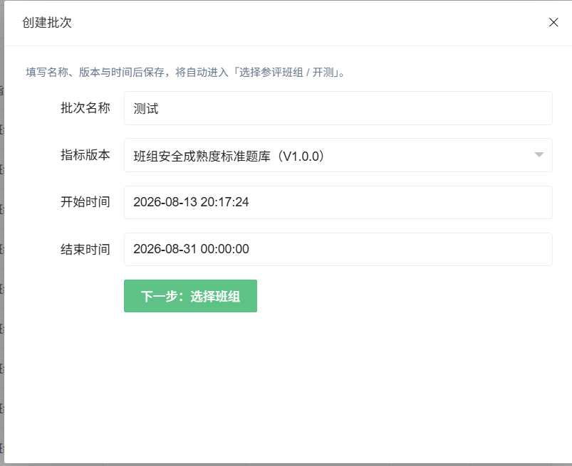

### 5.3 绑定班组与开测

在批次详情中：

1. 在组织树中勾选参评班组；勾选父级时，通常会联动勾选其下可选班组。  
2. **占用规则**：同一班组在时间重叠的未结束批次中，一般不能再被选中（界面上常会标红或不可勾）。已结束批次不再占用。  
3. 保存绑定。开测前可以改班组；**开测后绑定锁定**。  
4. 确认无误后点击 **开测（抽题写快照）**，按提示确认。  
5. 开测成功后页面展示小程序码（配置了微信参数时为正式小程序码，否则可能显示路径码备用）。  
6. 点击 **导出二维码**，将图片发给班组（文件名一般为批次名称）。员工用微信扫码进入答题。

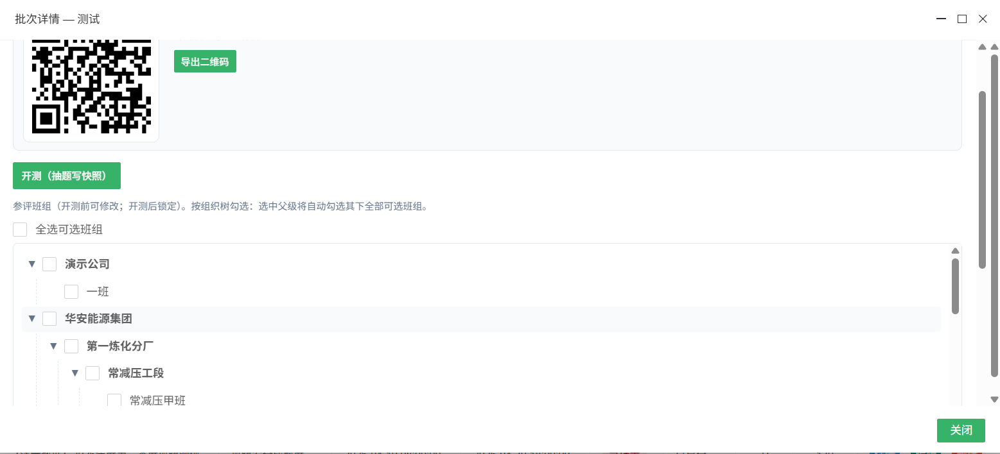

### 5.4 进行中：看进度

批次状态为 **进行中** 时：

- 员工可扫码进场、答题、交卷（须在批次时间窗内，且批次已开测）；  
- 详情里可查看各班组提交进度（已交 / 未交等），便于催办。  

> 说明：员工手机微信扫码，需要服务器已配置公网 HTTPS 域名，并在微信公众平台配置合法 request 域名；仅本机或内网 IP 时，一般只能用开发者工具/体验成员调试，不能直接给全体员工扫。具体见部署与发码说明。

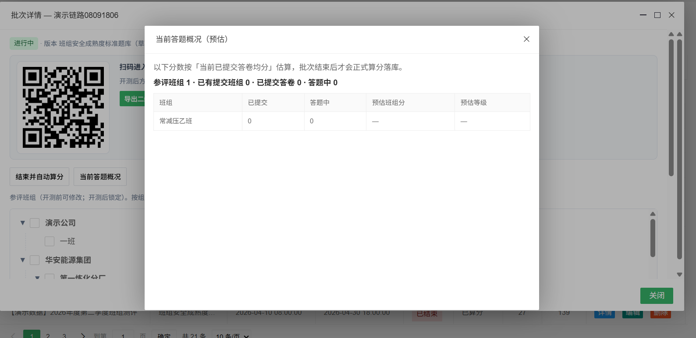

### 5.5 结束与算分

- 点击 **结束并自动算分**：结束后不可再登记作答，系统会按已提交答卷计算班组均分、等级与薄弱指标并落库。  
- 若规则或措施有调整，可对已结束批次使用 **重新算分**（以页面确认为准）。  
- 班组均分一般只统计 **已提交** 成员；无人提交时，该班组通常没有有效结果。

---

## 6. 结果查询

路径：**测评管理 → 结果查询**

用于按批次查看正式测评结果：

1. 先选择 **测评批次**；  
2. 可再按等级、班组名称等筛选（输入或下拉后一般会自动刷新）；  
3. 列表中查看班组得分、等级、排名等信息；  
4. 进入 **班组详情**，可看薄弱指标与赋能建议，以及个人答卷；  
5. 需要时使用页面上的 **导出**（如 Excel）。  

列表支持分页（常见默认每页 10 条，可按页面选项调整）。


---

## 7. 统计分析

统计分析侧重「汇总看、对比看、汇报用」，数据来自已算分的批次结果。

### 7.1 成熟度看板

路径：**统计分析 → 成熟度看板**

可按批次、组织查看：

- 汇总 KPI  
- 等级分布图  
- 各等级数量与占比明细  
- 班组得分清单（支持分页）  

适合例会或汇报时快速说明「这一轮整体处于什么水平」。

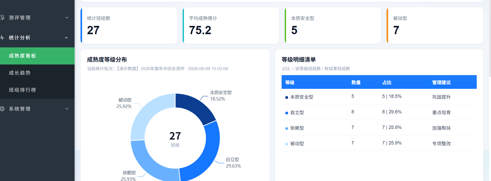

### 7.2 成长趋势

路径：**统计分析 → 成长趋势**

用来对比同一班组（或多个班组）在不同批次之间的得分变化。

建议操作：

1. 先选组织，缩小班组范围；  
2. 勾选需要对比的班组；  
3. 刷新/查看趋势图。  

组织下钻时，注意右侧图例与横轴批次是否完整显示；班组较多时可分批勾选查看。

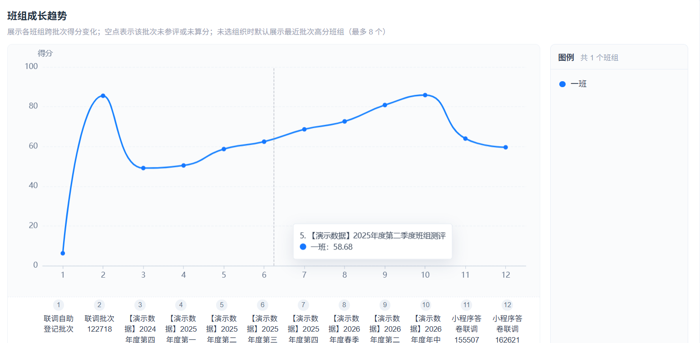

### 7.3 班组排行榜

路径：**统计分析 → 班组排行榜**

按得分从高到低展示班组排行，并配柱状图（图中通常展示前列班组；完整名次以表格为准，表格支持分页）。需要对外报送时，可按页面提供的方式导出（如 PDF/Excel，以实际按钮为准）。


---

## 8. 系统管理

### 8.1 管理员账号

路径：**系统管理 → 管理员账号**

维护可登录 PC 后台的账号：新增、编辑、启停、重置密码等。  
**正式环境务必修改默认密码**，并为实际使用人单独建号，避免多人共用一个 admin。

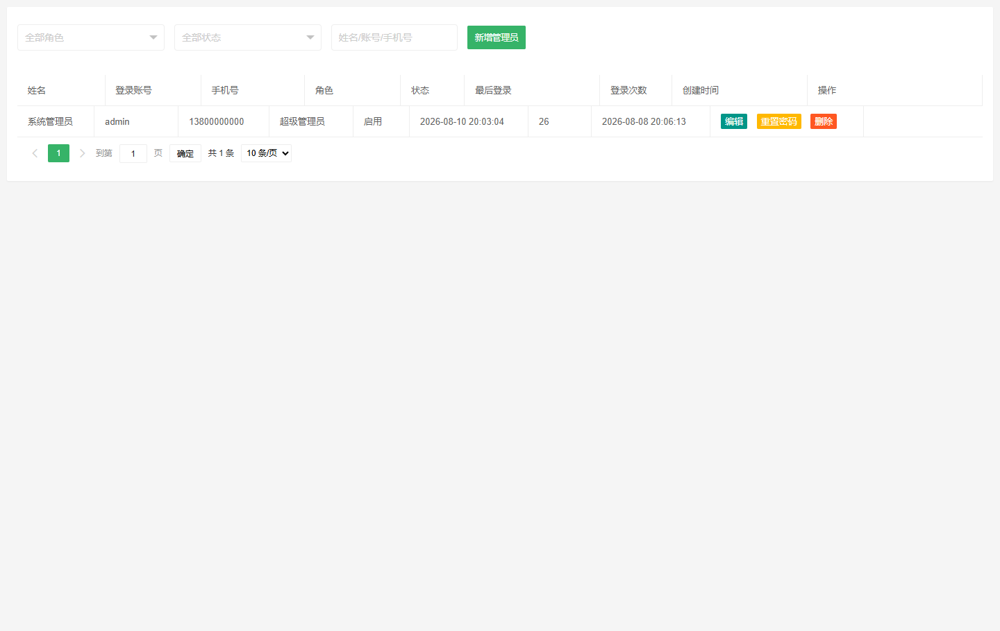

### 8.2 角色权限

路径：**系统管理 → 角色权限**

为角色勾选可见菜单/功能，再把角色赋给管理员账号。  
例如：只负责查结果的账号，可不开放「题库维护」「系统管理」等菜单。

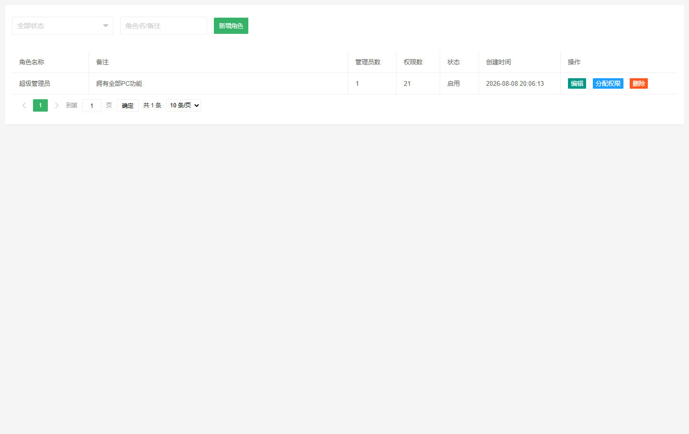

### 8.3 导入任务

路径：**系统管理 → 导入任务**（若菜单已开放）

组织、班组等批量导入后，可在此查看任务状态与失败明细，便于核对哪一行没导进去。

### 8.4 操作日志

路径：**系统管理 → 操作日志**

记录后台关键操作（如登录相关、业务变更等），便于审计和排查「谁在什么时候改过」。


---

## 9. 常见问题

| 情况 | 处理建议 |
|------|----------|
| 登录后页面样式很乱、像没加载 CSS | 强制刷新（Ctrl+F5）；确认访问地址与端口正确；联系运维检查静态资源是否部署完整 |
| 创建批次时选不到指标版本 | 先到「指标版本」确认是否有 **已发布** 状态的版本 |
| 某些班组无法勾选 | 可能已被时间重叠的未结束批次占用；等对方批次结束，或调整时间窗 |
| 开测按钮点不了 / 提示失败 | 检查是否已绑班组；题库是否满足发布校验（权重、每三级至少有题等） |
| 员工扫码进不去 | 确认批次已开测且在时间窗内；正式环境需 HTTPS 域名与微信合法域名配置 |
| 结果页没有班组数据 | 确认是否已结束并算分；是否有人已提交；筛选条件是否过窄 |
| 改了题库但旧批次题目没变 | 正常现象：开测后认快照；新题目只影响之后新开测的批次 |
| 忘记管理员密码 | 由具备权限的管理员在「管理员账号」中重置，或联系运维 |

---

## 附：一次完整测评怎么走（极简版）

1. 组织、班组建好；指标版本发布。  
2. 创建批次 → 绑班组 → 开测 → 导出码。  
3. 员工小程序答题交卷。  
4. 结束并算分。  
5. 结果查询 / 统计分析查看与导出。  

如与现场菜单名称略有差异，以实际系统界面为准。
)
