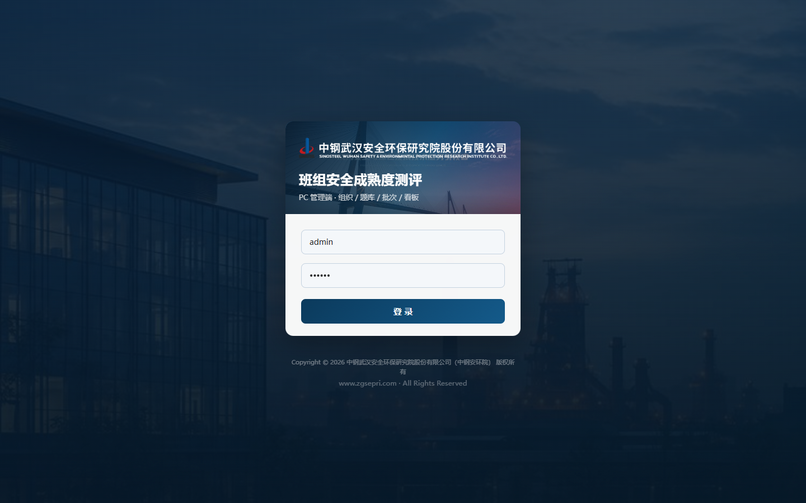
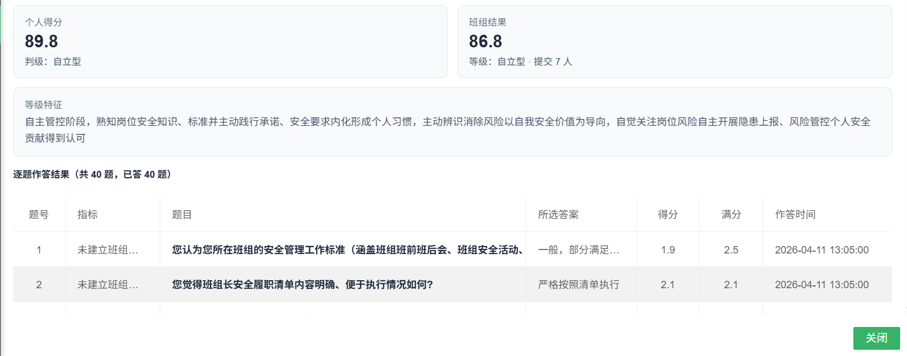
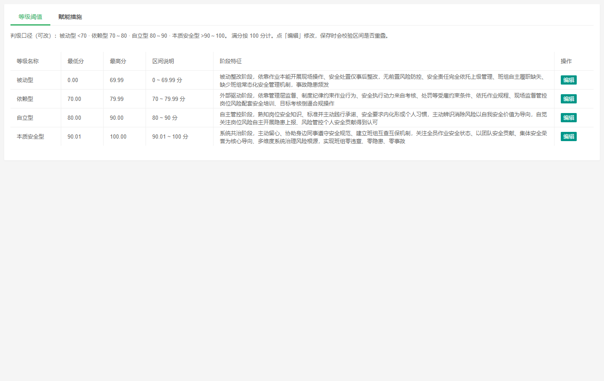
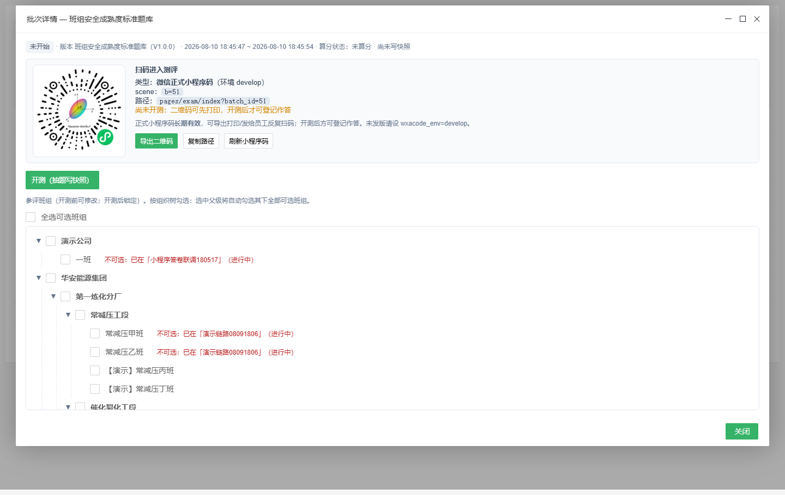
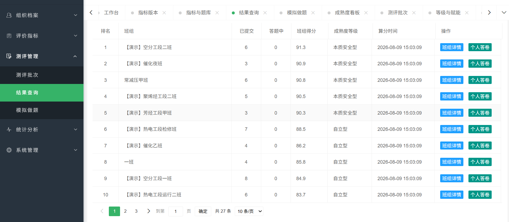
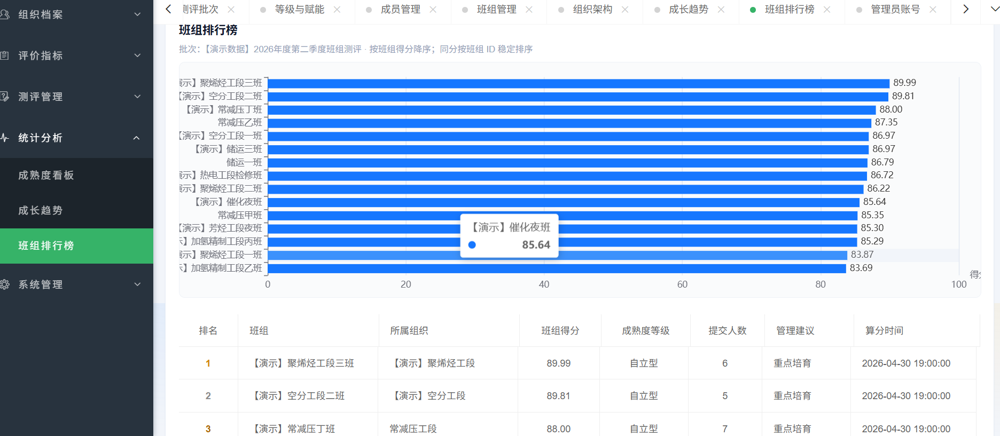
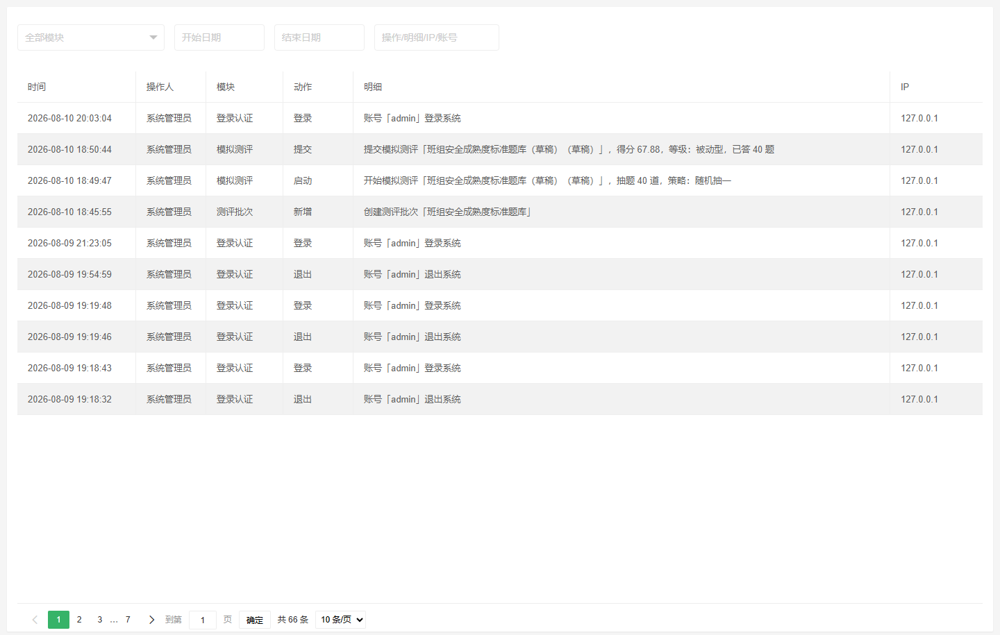

# 班组安全成熟度测评系统  
# PC 管理端用户使用手册

## 目录

1. [系统简介与登录](#1-系统简介与登录)  
2. [界面总览与工作台](#2-界面总览与工作台)  
3. [组织档案](#3-组织档案)  
4. [评价指标与题库](#4-评价指标与题库)  
5. [测评批次（核心流程）](#5-测评批次核心流程)  
6. [结果查询](#6-结果查询)  
7. [统计分析](#7-统计分析)  
8. [系统管理](#8-系统管理)  


---

## 1. 系统简介与登录

### 1.1 系统做什么

本系统用于组织 **班组安全成熟度测评**：

1. 在 PC 后台维护组织/班组、题库与测评批次；  
2. 开测后生成小程序码，员工用微信小程序答题；  
3. 交卷后在 PC 查看个人/班组结果，并通过看板、趋势、排行做分析。

> PC 端主要给少数人发测评、看结果；大规模答题在小程序完成。

### 1.2 如何登录

1. 浏览器打开系统地址（后期部署后会提供）。  
2. 输入账号、密码，点击 **登录**。  

测试环境默认账号（上线后请立即修改）：

- 账号：`admin`  
- 密码：`123456`



**说明：** 连续输错密码可能被临时锁定，请稍后再试或联系管理员解锁。

---

## 2. 界面总览与工作台

登录成功后进入后台主界面。左侧为功能菜单，右侧为内容区。

主要菜单：

| 一级菜单 | 用途 |
|----------|------|
| 组织档案 | 组织架构、班组、成员 |
| 评价指标 | 指标版本、题库、等级与赋能 |
| 测评管理 | 测评批次、结果查询、模拟做题 |
| 统计分析 | 成熟度看板、成长趋势、班组排行 |
| 系统管理 | 管理员、角色、导入任务、操作日志 |

### 2.1 工作台

工作台可快速查看最近批次的成熟度概况：统计班组数、平均分、各等级数量与分布图。可按 **批次**、**组织** 筛选。


---

## 3. 组织档案

测评前需先有可用的组织与班组（人员可在小程序答题时现场登记，不必事先全部导入）。

### 3.1 组织架构

路径：**组织档案 → 组织架构**

用于维护公司/厂/工段等层级树。可新增下级组织、调整名称与状态。


### 3.2 班组管理

路径：**组织档案 → 班组管理**

班组挂在某个组织节点下。创建批次时将勾选参评班组。


### 3.3 成员管理

路径：**组织档案 → 成员管理**

可查看、编辑成员，按班组、角色、姓名/手机筛选


**操作提示：**

- 筛选「全部角色 / 全部班组」会显示全部成员。  
- 正式测评以小程序自助填姓名为主，成员库用于补录与查询。

### 3.4 班组答题详情


路径：**班组管理 → 班组详情**

可以查看整个班组的答题详情，具体得分情况


**操作提示：**

- 可以通过筛选「测评批次」筛选出。

### 3.4 个人答题详情

路径：**成员管理 → 答题记录**

可以查看个人的答题详情，具体得分情况


点击查看结果，即可查看具体批次的个人答题情况



## 4. 评价指标与题库

### 4.1 指标版本

路径：**评价指标 → 指标版本**

指标版本有状态：**草稿 / 已发布 / 停用**。

- 仅 **草稿** 可维护题库结构；  
- 创建测评批次时，只能选择 **已发布** 版本；  
- 已发布/停用版本不再显示「维护题库」（防止误改正式标准）。


### 4.2 指标与题库

路径：**评价指标 → 指标与题库**

在指定版本下维护一级/二级/三级指标及题目、选项。开测时系统按规则从题库抽题写入批次快照。


### 4.3 等级与赋能

路径：**评价指标 → 等级与赋能**

配置成熟度等级分数区间（如本质安全型、自立型、依赖型、被动型）及薄弱指标对应的赋能措施文案。算分与结果展示会引用此处配置。



---

## 5. 测评批次（核心流程）

路径：**测评管理 → 测评批次**

这是 PC 端最常用模块：创建批次 → 绑定班组 → 开测 → 导出小程序码 → 结束/算分。


列表说明：

| 列 | 含义 |
|----|------|
| 状态 | 未开始 / 进行中 / 已结束 |
| 算分 | 未算分 / 已算分 等 |
| 班组 | 已绑定班组数 |
| 已提交 | 已交卷人数 |

### 5.1 推荐操作顺序

```text
① 确认有「已发布」的相关题库
② 创建批次（选版本、填名称与时间）
③ 详情中绑定参评班组（树形勾选）
④ 点击「开测」（生成试卷快照）
⑤ 导出/打印小程序码发给员工
⑥ 员工小程序答题交卷
⑦ 结束后算分，到「结果查询 / 统计分析」查看
```

### 5.2 创建批次

1. 点击 **创建批次**。  
2. 填写批次名称、选择已发布指标版本、开始/结束时间。  
3. 保存后回到列表，点 **详情** 继续配置。

### 5.3 绑定班组与开测

在批次 **详情** 中：

1. 在组织树中勾选班组（勾选上级可联动下级班组）。  
2. 注意：已被其他未结束批次占用的班组可能不可选。  
3. 保存绑定后，点击 **开测**。  
4. 开测成功后生成试卷快照；页面展示 **微信小程序码**。  
5. 可 **刷新小程序码**、**导出二维码**（文件名一般为批次名称）。



### 5.4 进行中与结束

- **进行中**：员工可扫码进场答题（需小程序已配置并可访问服务器）。  
- **结束**：停止测评；按需执行 **算分**，生成班组均分、等级与薄弱指标。  
- 详情中可查看各班组提交进度。

---

## 6. 结果查询

路径：**测评管理 → 结果查询**

1. 选择测评批次（可再按等级、班组名筛选）。  
2. 查看班组排名、得分、等级。  
3. 可进入 **班组详情**、查看 **个人答卷**

列表支持分页（默认每页 10 条）。



---

## 7. 统计分析

### 7.1 成熟度看板

路径：**统计分析 → 成熟度看板**

按批次、组织查看 KPI、等级分布饼图、等级明细与班组得分清单（清单可分页）。


### 7.2 成长趋势

路径：**统计分析 → 成长趋势**

对比班组在不同批次中的得分变化。建议先选择组织，再勾选需要对比的班组后刷新趋势。


### 7.3 班组排行榜

路径：**统计分析 → 班组排行榜**

按得分降序展示班组排行与柱状图（图表为前列班组，表格支持分页），可导出 Excel/PDF。



---

## 8. 系统管理

### 8.1 管理员账号

路径：**系统管理 → 管理员账号**

维护可登录 PC 后台的账号。上线后请修改默认密码。


### 8.2 角色权限

路径：**系统管理 → 角色权限**

为角色分配菜单权限，控制不同账号可见模块。


### 8.3 操作日志

路径：**系统管理 → 操作日志**

查看关键操作记录，便于审计与排查。



---


