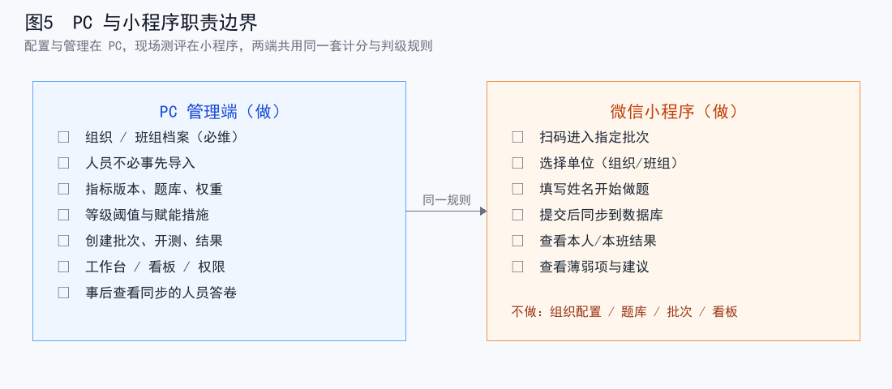
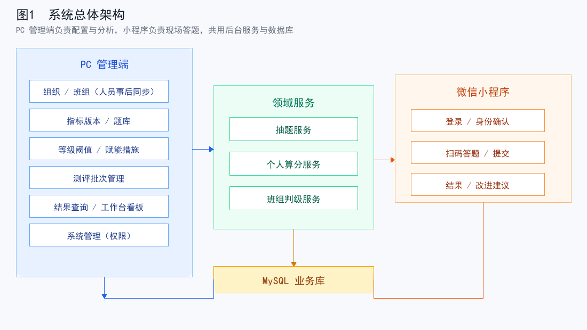
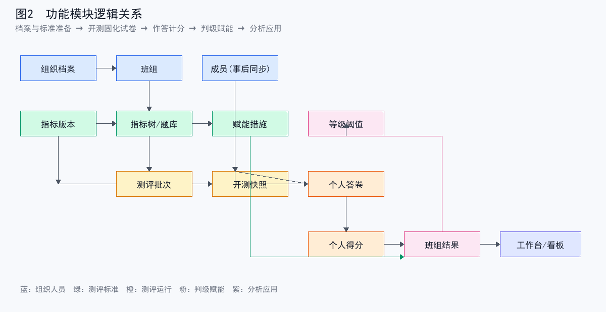
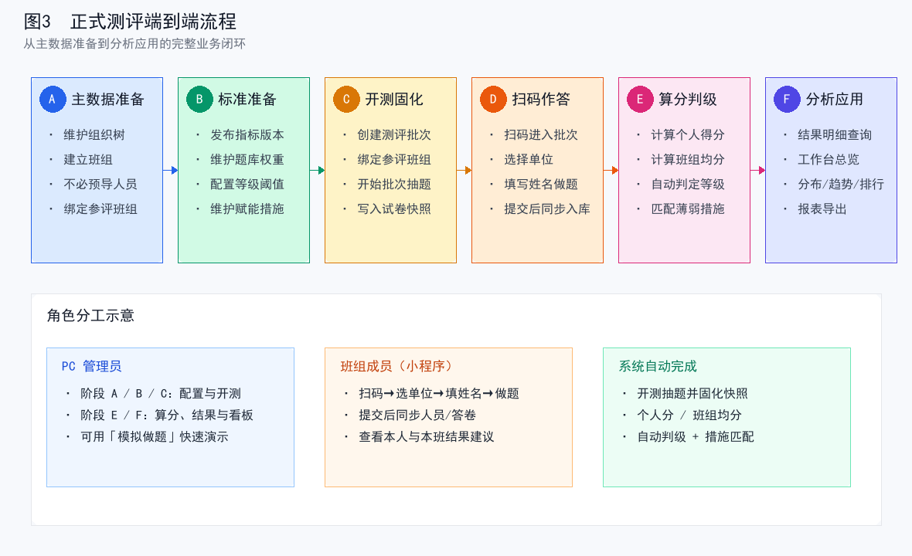
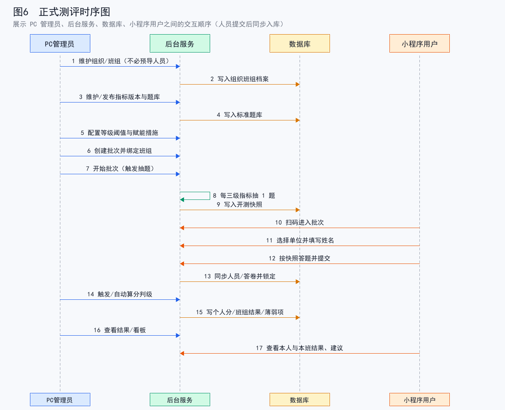
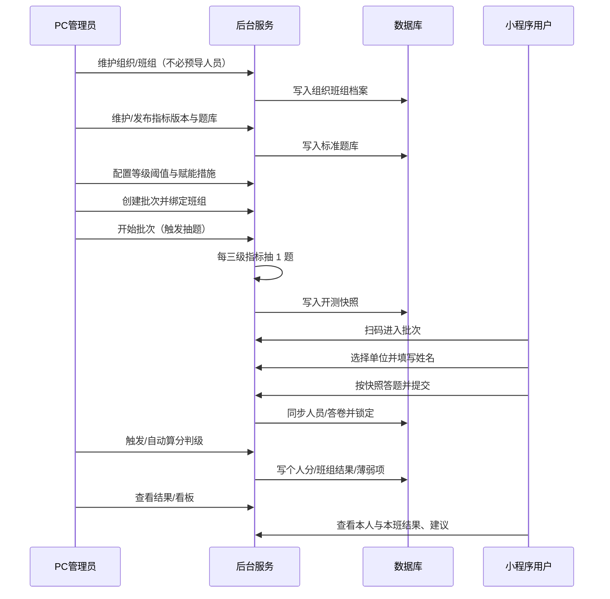
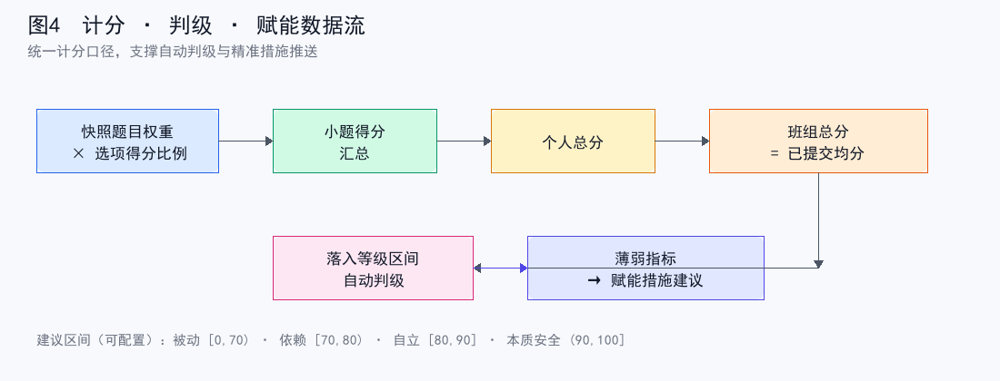

# 班组安全成熟度测评系统  
## 功能与方案说明（客户演示用）

| 项 | 内容 |
|----|------|
| 文档用途 | 客户演示：说明系统定位、设计思路与功能范围 |
| 文档性质 | 功能需求说明 + 方案设计概要（含关系图 / 流程图） |
| 说明 | **不含开发进度**；具体实现以双方确认的需求与部署环境为准 |
| Word 版 | [`客户演示-系统功能与方案说明.docx`](./客户演示-系统功能与方案说明.docx) |
| 图表源文件 | [`demo-diagrams/`](./demo-diagrams/) |
| 重新导出 | `php scripts/export-demo-docx.php` |

---

## 1. 系统是什么

本系统以班组**四级成熟度模型**为标尺，把线下成熟度评估搬到线上，形成「测评 → 判级 → 赋能 → 分析」闭环：

| 成熟度等级 | 含义（业务语义） |
|------------|------------------|
| 被动型 | 安全工作被动应对 |
| 依赖型 | 主要依靠外部督促与制度约束 |
| 自立型 | 班组具备较强自主管理能力 |
| 本质安全型 | 安全文化与管理达到更高水平 |

**要解决的四件事：**

1. **线上测评** — 按标准题库统一作答、统一计分  
2. **分级画像** — 按班组总分自动判定成熟度等级，并展示阶段特征  
3. **精准赋能** — 针对薄弱指标推送建设措施与改进建议  
4. **分析看板** — 等级分布、成长趋势、排行等，支撑管理决策  

---

## 2. 端侧分工与职责边界

系统采用 **PC 管理端为主、微信小程序为辅** 的分工：配置与标准在 PC，现场测评在小程序，两端共用同一套计分与判级规则。

---

## 3. 总体方案设计

### 3.1 系统总体架构

| 层 | 作用 |
|----|------|
| 展示层 | PC 管理后台页面；微信小程序页面 |
| 应用层 | 业务功能入口（组织、题库、批次、结果、看板等） |
| 领域服务 | 抽题、个人算分、班组判级、导入与审计 |
| 数据层 | 独立业务库，组织/题库/批次/答卷/结果等数据隔离存储 |

### 3.2 功能模块逻辑关系

各功能不是孤立菜单，而是按业务依赖串联：

- 开测前需维护组织 / 班组与题库标准；**人员不必事先导入**。  
- 没有指标版本与题库，批次无法抽题。  
- 没有等级阈值，无法自动判级。  
- 没有赋能措施，结果只能出分、无法「精准帮扶」。  
- 小程序：扫码 → 选单位 → 填姓名 → 做题；提交后同步人员与答卷；配置全在 PC。  

| 模块 | 输入依赖 | 产出/服务对象 | 关键关联 |
|------|----------|----------------|----------|
| 组织档案 | — | 班组挂载点 | 组织 → 班组 |
| 班组管理 | 组织 | 批次绑定对象 | 批次 ↔ 班组 |
| 成员管理 | 班组 | 事后归集/补全 | 扫码填姓名 → 提交后同步成员/答卷 |
| 指标版本/题库 | — | 批次抽题来源 | 版本 → 指标 → 题目 → 选项 |
| 等级阈值 | — | 判级规则 | 阈值 ← 班组结果等级 |
| 赋能措施 | 指标、等级 | 结果页建议 | 措施 → 三级指标 |
| 测评批次 | 版本、班组 | 快照、答卷、结果 | 批次是测评事务中心 |
| 模拟做题 | 版本、阈值、措施 | 演示结果 | 复用抽题/算分/判级 |
| 结果/看板 | 班组结果 | 管理决策 | 分布 / 趋势 / 排行 |
| 系统管理 | — | 权限与审计 | 角色 → 菜单；操作写日志 |

### 3.3 正式测评端到端流程

**模拟做题（联调 / 现场演示）：** PC 选择指标版本即时抽题作答，按同口径出分 / 判级 / 看建议，不写入正式批次数据。

### 3.4 正式测评时序图

按交互顺序展示四方协作：PC 维护组织/班组与标准并开测；用户扫码后选单位、填姓名并答题；提交后同步人员与答卷；后台算分判级。

### 3.5 计分、判级与赋能

| 等级 | 区间约定（满分 100，可配置） |
|------|------------------------------|
| 被动型 | [0, 70) |
| 依赖型 | [70, 80) |
| 自立型 | [80, 90] |
| 本质安全型 | (90, 100] |

### 3.6 关键业务规则

1. **不必事先导入人员。** 用户扫码进入批次后，选择单位（组织/班组）并填写姓名即可开始做题；提交后将作答人与答卷同步到数据库。  
2. 开测时每个三级指标抽取 1 道题进入快照；答题只认快照。  
3. 答卷提交后锁定，不可再改。  
4. 班组均分仅统计已提交成员；无人提交则无有效班组结果。  
5. 组织层级不强制固定为 2 层或 3 层；班组可挂靠任意组织节点。  
6. 已发布指标版本不宜直接改题；重大变更建议复制新版本，保证历史可比。  

### 3.7 非功能设计要点

| 类别 | 方案要点 |
|------|----------|
| 安全 | PC 登录鉴权与角色菜单授权；小程序在身份确认后访问对应班组/本人结果数据 |
| 一致性 | 开测快照隔离题库后续修改；答卷提交后不可改 |
| 审计 | 关键操作可追溯；批量导入保留任务与失败明细 |
| 扩展 | 支持一指标多题与抽题策略；组织深度可变；措施可按等级扩展 |

---

## 4. 系统功能说明

以下按业务模块说明系统具备的能力（共 50 项）。每项包含**功能名称**与**能力说明**，便于客户理解「能做什么、解决什么问题」。**不含开发进度。**

### 4.1 成熟度模型与判级

**1. 班组四级成熟度模型**  
系统内置并贯穿全流程使用四级成熟度标尺：被动型、依赖型、自立型、本质安全型。测评结果不是简单的「及格/不及格」，而是把班组定位到可理解的成长阶段，便于横向对比与纵向跟踪。

**2. 各等级分数区间可配置**  
四级对应的分数上下限可在管理端维护（建议默认：被动＜70、依赖 70～80、自立 80～90、本质安全＞90）。企业可根据自身标准微调边界，无需改程序。

**3. 各等级阶段特征描述可配置与展示**  
每个等级可配置阶段特征文案（如管理特点、风险表现、改进方向）。结果页、工作台等位置展示这些描述，帮助管理者快速读懂「这个等级意味着什么」。

**4. 按班组测评总分自动判定成熟度等级**  
班组得分计算完成后，系统自动匹配分数区间并给出等级，减少人工判读差异，保证同一批次、同一标准下口径一致。

### 4.2 组织与人员档案（PC）

**5. 组织架构管理（树形，层级不强制固定）**  
支持树形维护企业组织（如公司—厂区—车间—工段等），不强制只能做 2 层或 3 层。可新增、编辑、调整上下级关系，作为班组挂靠与后续按组织分析的基础。

**6. 班组管理（班组挂靠所属组织）**  
在组织节点下维护班组档案（名称、所属组织、状态等）。班组是参评单元：测评批次绑定班组、算分判级以班组为单位汇总。停用班组可限制其加入新批次。

**7. 成员管理（事后同步，非开测前置）**  
正式测评不要求事先导入人员名单。成员在小程序扫码作答时选择单位并填写姓名；提交后系统将人员与答卷同步入库。PC 端可事后查看、补全或维护成员信息。

**8. 成员角色区分**  
预置班组长、组长、安全员、兼职安全员、普通成员等角色标签；现场填姓名方案下角色可弱化/选填（是否仍限制岗位参评待确认）。

**9. 组织 / 班组 Excel 导入（成员导入非前置）**  
组织/班组可批量导入。人员名单不是开测前置条件；测评人员以扫码现场填写并事后同步为主。

**10. 导入任务记录与失败明细查询**  
如需批量维护组织/班组等基础数据，导入任务可记录成功/失败及失败明细。

### 4.3 评价指标与题库（PC）

**11. 指标版本管理（多套指标体系）**  
支持维护多套指标版本（如 V1.0、年度修订版）。正式测评时指定使用哪一版本，历史批次仍按开测时版本口径解释，避免标准升级后「旧账新算」。

**12. 三级指标体系（含权重）**  
按一级 / 二级 / 三级维护指标树，并为指标设置权重。一级权重合计建议为 100；三级指标权重直接参与题目计分，保证不同能力维度在总分中的贡献可控。

**13. 标准测评题库**  
每道题包含题干、选项，并挂靠到具体三级指标。选项体现不同成熟度表现，使测评内容与指标体系一一对应，而不是零散问卷。

**14. 「指标权重 × 选项得分比例」计分**  
统一计分口径：小题得分 = 该题对应三级指标权重 × 所选选项得分比例（如 1.0 / 0.75 / 0.5 / 0.25）。个人总分由小题得分累加得到，规则透明、可复核。

**15. 题库浏览与按指标树定位**  
管理端可按指标树展开浏览题目与选项，便于审核题库完整性、核对某指标下是否有题、选项比例是否合理。

**16. 一指标多题 + 开测抽 1 题**  
同一三级指标可挂多道备选题，形成题池；开测时每个三级指标抽取 1 道进入本批次试卷。既保证覆盖全部三级指标，又为后续轮换出题留扩展空间。

### 4.4 等级与精准赋能（PC）

**17. 等级阈值维护**  
维护各等级名称、最低分、最高分及阶段特征；保存时可做区间合理性校验（如避免重叠）。这是自动判级的规则来源。

**18. 赋能 / 建设措施维护**  
维护针对薄弱点的建设措施文案（做什么、怎么改）。措施与指标体系关联，使测评结果能落到可执行改进动作，而不是只给一个分数。

**19. 每指标 × 四等级措施建议**  
建议按「每个三级指标 × 四个成熟度等级」维护措施内容。同一薄弱点在不同等级下可给出差异化帮扶建议，支撑「精准赋能」。

**20. 测评后按薄弱指标推送措施**  
答卷与算分完成后，系统识别未拿满分或失分较多的薄弱指标，自动匹配对应建设措施，在结果页向管理员与成员展示改进建议。

### 4.5 测评业务

**21. 创建测评批次**  
管理员创建一次正式测评事务：选择指标版本、设定测评周期/时间窗、填写批次名称等。批次是后续绑班组、抽题、答题、出结果的统一容器。

**22. 批次绑定参评班组**  
将需要参加本次测评的班组加入批次。未绑定班组不参评；同一批次可覆盖多个班组，便于集中组织与横向对比。

**23. 批次状态管理（开始 / 进行中 / 结束）**  
批次具备明确生命周期。开始后进入可答状态；结束后停止新答或收口统计。状态清晰，便于现场组织和进度管控。

**24. 开测抽题并固化试卷快照**  
点击开始批次时，系统按规则抽题并生成「本批次试卷快照」。此后成员只答快照中的题目；即使后台再改题库，也不影响本次进行中的测评，保证公平与可追溯。

**25. 查看批次答题进度（已答 / 未答）**  
管理端可查看各班组/成员答题进度，掌握谁已提交、谁未完成，便于催办与掌握收卷节奏。

**26. 个人作答与提交锁定**  
成员逐题作答并提交；提交后答卷锁定，不可再改，避免事后改分争议，保证结果严肃性。

**27. 个人得分计算**  
按统一公式自动计算每位已提交成员的个人总分，并保留小题得分明细，支持结果复核与薄弱点分析。

**28. 班组得分计算（已提交均分）**  
班组总分 = 该班组已提交个人总分的平均值；未提交成员不计入。无人提交时不产生有效班组结果，避免「空数据假均分」。

**29. 班组自动判级**  
根据班组总分自动匹配等级阈值，给出成熟度等级及阶段特征，减少人工判定主观差异。

**30. 结果查询（班组汇总 + 个人明细）**  
管理端可查询本批次班组成绩汇总，并下钻查看个人答卷、选项与小题得分，满足「既看整体、也看个体」的管理需要。

**31. 薄弱指标清单 + 赋能建议**  
结果中列出薄弱指标排序及对应建设措施，形成「哪里弱 → 怎么改」的闭环信息，支撑班组整改与帮扶。

**32. 结果导出**  
支持将班组结果、排行等信息导出为 Excel 等格式，方便线下汇报、存档或二次分析。

**33. PC 端模拟做题**  
无需创建正式批次即可选择指标版本抽题、作答、出分、判级并查看建议。用于培训演示、口径确认与联调验证；不写入正式批次数据，不影响真实测评台账。

### 4.6 小程序答题端

**34. 微信登录**  
成员使用微信身份进入小程序，降低现场账号密码门槛，适合班组现场快速开测。

**35. 扫码选单位并填写姓名（无需预导人员）**  
现行逻辑：不事先导入人员。用户扫码进入指定测评批次后，选择单位（组织/班组）、输入姓名，即可开始做题；提交后将人员与答卷数据同步到数据库，保证答卷归属明确班组，支撑班组均分与结果追溯。

**36. 扫码进入指定测评批次**  
扫描批次二维码直接进入对应测评；进入后选择单位并填写姓名即可作答。无需事先导人员，适合集中组织考试场景。

**37. 在线答题与提交**  
按开测快照展示题目与选项，支持逐题作答并提交；提交时同步人员与答卷并锁定。

**38. 查看本人得分与本班组成熟度结果**  
提交并完成算分后，成员可查看个人得分，以及本班组总分、成熟度等级等结果，增强参与感与反馈及时性。

**39. 查看薄弱项与改进建议**  
成员可查看本班/本人相关薄弱指标及改进建议，使测评结果直接转化为班组改进动作指引。

### 4.7 统计分析与工作台（PC）

**40. 工作台总览 KPI**  
首页集中展示关键管理指标：如班组总数、平均成熟得分、本质安全型班组数、被动型班组数等，帮助管理层「一眼看现状」。

**41. 成熟度等级分布图**  
以环形图等方式展示各等级班组数量分布，直观呈现整体结构（高成熟度占比、低成熟度占比）。

**42. 等级明细清单**  
列出各等级数量、占比及对应管理建议/阶段特征，把图表信息落到可阅读、可汇报的清单。

**43. 成熟度看板（按组织等维度）**  
支持按组织等维度查看成熟度分布，便于发现薄弱单位、组织帮扶资源，而不只看全公司平均数。

**44. 班组成长趋势（跨批次）**  
对比同一班组在不同测评批次中的得分变化，观察提升或回落，支撑持续改进与复盘。

**45. 班组排行榜**  
按得分或等级对班组排序，形成可比激励视图，并可与导出能力结合用于通报或竞赛场景。

### 4.8 系统管理（PC）

**46. 管理员账号管理**  
维护后台管理员账号：新增、编辑资料、启用/停用、重置密码等，保障管理端人员可管可控。

**47. 角色管理**  
定义不同管理角色（如系统管理员、业务管理员、只读查看等），为权限分配提供载体。

**48. 菜单 / 功能权限分配**  
按角色授权可见菜单与可操作功能，实现职责分离：例如有人只维护档案、有人只看结果、有人可改题库。

**49. 操作日志查询**  
记录关键操作痕迹，支持事后审计与问题追溯（谁在何时做了什么），提升系统合规与可管理性。

**50. PC 管理端登录与退出**  
提供安全的管理端登录认证与退出能力，保障未授权人员无法进入配置与结果数据区域。

---

## 5. 演示时建议强调的设计亮点

1. **PC 配置、小程序答题** — 职责清晰，现场操作轻、管理侧能力完整。  
2. **批次快照机制** — 开测后题库调整不影响进行中的测评，保证公平与可追溯。  
3. **个人分 → 班组均分 → 自动判级 → 措施推送** — 形成完整管理闭环。  
4. **一指标 × 四等级措施** — 结果不只是分数，还能落到可执行的建设建议。  
5. **模拟做题** — 无正式批次时也能完整演示计分、判级与赋能效果。  

---

## 6. 建议与客户当场确认的事项

| # | 事项 | 客户意见 |
|---|------|----------|
| A | 四级分数边界是否按：被动＜70、依赖 70～80、自立 80～90、本质安全＞90 | |
| B | 现场填姓名后是否仍限制岗位参评（或扫码人均可答） | |
| C | 小程序是否纳入本期范围（或先 PC 批次 + 模拟做题，小程序二期） | |
| D | 看板 / 排行 / 导出是否纳入本期范围 | |
| E | 题库是否允许后期「一指标多题」随机抽题 | |
| F | 赋能措施是否按「每指标 × 四等级」维护 | |
| G | ~~身份确认方式~~ **已确认**：扫码选单位 + 填姓名，人员事后同步 | 已确认 |

---

## 7. 功能范围确认（可打印勾选）

请在确认纳入范围的模块前打勾：

- [ ] 一、成熟度模型与判级（1～4）  
- [ ] 二、组织与人员档案（5～10）  
- [ ] 三、评价指标与题库（11～16）  
- [ ] 四、等级与精准赋能（17～20）  
- [ ] 五、测评业务（21～33）  
- [ ] 六、小程序答题端（34～39）  
- [ ] 七、统计分析与工作台（40～45）  
- [ ] 八、系统管理（46～50）  

---

*本文用于客户演示与功能/方案说明，不描述开发进度与内部实现状态。Word 版已嵌入全部关系图与流程图。*
