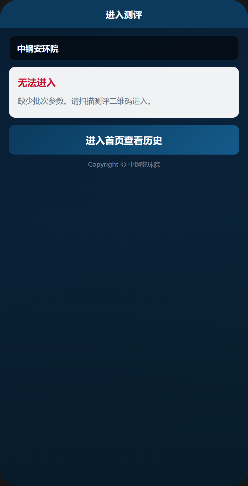
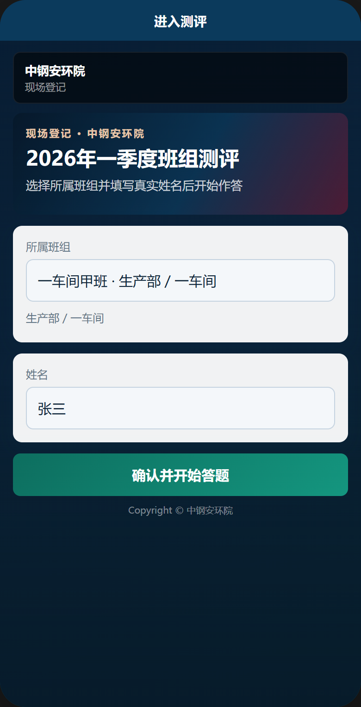
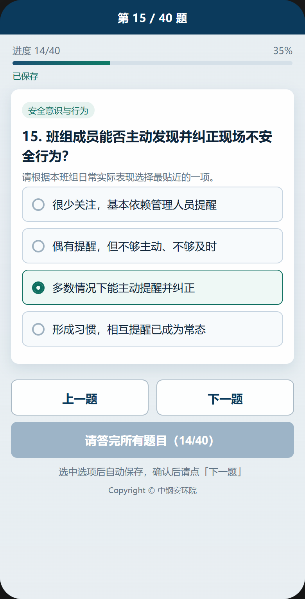
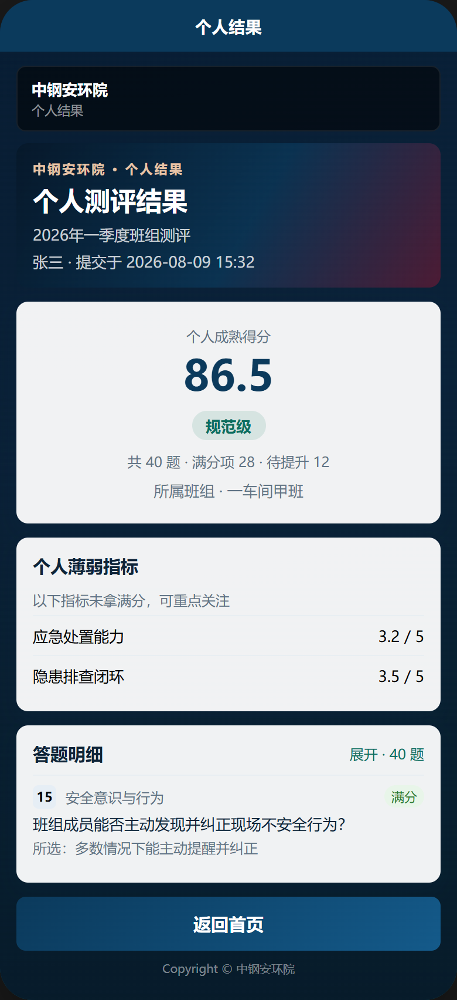
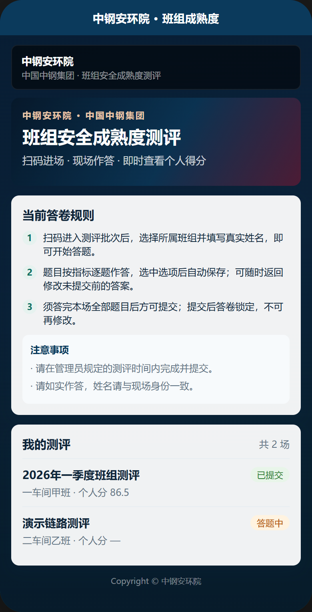

# 班组安全成熟度测评系统  
# 微信小程序 · 员工答题手册

| 项目 | 说明 |
|------|------|
| 适用对象 | 参加测评的班组成员（员工） |
| 客户端 | 微信小程序「中钢安环院 · 班组成熟度」 |
| 品牌 | 中钢安环院 |
| 文档版本 | V1.0（2026-08） |
| 配图说明 | 界面示意按小程序实际布局还原；文案与分数为示例，以现场测评为准 |

> 管理端（建批次、发码、看班组结果）见 [`PC端用户使用手册.md`](./PC端用户使用手册.md)。

---

## 目录

1. [测评是什么](#1-测评是什么)  
2. [如何进入（扫码）](#2-如何进入扫码)  
3. [登记：选班组与姓名](#3-登记选班组与姓名)  
4. [答题与保存](#4-答题与保存)  
5. [提交答卷](#5-提交答卷)  
6. [查看个人结果](#6-查看个人结果)  
7. [首页与历史测评](#7-首页与历史测评)  
8. [常见问题](#8-常见问题)  

---

## 1. 测评是什么

本小程序用于 **班组安全成熟度** 个人答题：

1. 管理员在 PC 开测后，向员工发放 **微信小程序码**；  
2. 员工用微信扫码进入对应 **测评批次**；  
3. 选择所属班组、填写真实姓名后作答；  
4. 全部答完并提交后，可立即查看 **个人得分、等级、薄弱指标与答题明细**。

要点：

- 同一微信账号在同一批次 **只保留一份答卷**；  
- 提交后答卷 **锁定，不可再改**（除非管理员开启测试模式允许重测）；  
- 小程序只展示 **个人结果**，不含班组排名等管理端信息。

---

## 2. 如何进入（扫码）

### 2.1 正确方式

1. 使用手机 **微信** 扫一扫；  
2. 对准管理员发放的 **本场测评小程序码**（或长按识别图片中的码）；  
3. 进入后应看到本场批次名称，并进入「选班组 / 填姓名」登记页。

> 请勿使用未授权的第三方扫码工具；须用微信打开小程序。

### 2.2 扫码失败或无法进入

若出现类似「无法进入 / 缺少批次参数」：



常见原因：

| 现象 | 可能原因 | 建议 |
|------|----------|------|
| 提示缺少批次参数 | 未扫正式批次码，或从错误入口打开 | 重新扫描管理员导出的本场码 |
| 扫了但打不开 / 版本不对 | 小程序未发布正式版，或码与环境不一致 | 联系管理员重新导出码 |
| 网络错误、加载失败 | 手机网络差，或服务器未就绪 | 换网络后重试；仍失败联系管理员 |
| 提示当前不可进入 | 批次未开测、已结束，或本账号已交卷 | 从首页「我的测评」看历史；或询问管理员是否仍在测评时间 |

---

## 3. 登记：选班组与姓名

扫码成功后进入 **现场登记** 页：



操作步骤：

1. **所属班组**：点击选择器，从列表中选出自己所在班组（下方可能显示组织路径，便于核对）；  
2. **姓名**：填写 **真实姓名**（与现场身份一致，便于结果核对）；  
3. 点击 **确认并开始答题**。

注意：

- 班组列表由本场批次绑定决定，若没有自己的班组，请联系管理员补绑后再扫码；  
- 姓名勿随意填写或代他人登记；  
- 若本微信此前已在本场登记并答过题：  
  - 答题中：会直接进入试卷继续作答；  
  - 已提交：会进入个人结果页。

---

## 4. 答题与保存

进入试卷后，导航栏显示当前题号（如「第 15 / 40 题」），页面上方有进度条。



### 4.1 怎么答

1. 阅读题目上方的 **指标名称** 与题干；  
2. 点选最符合本班组实际的一项；  
3. 选中后系统会 **自动保存**（可见「正在保存… / 已保存」）；  
4. 确认无误后点 **下一题**；需要回看时点 **上一题**。

### 4.2 重要规则

- **须答完全部题目** 后才能提交（按钮会显示已答数量，如「请答完所有题目（14/40）」）；  
- 提交前可随时返回修改已选答案；  
- 保存过程中请勿频繁连点翻题；若提示「请等待保存完成」，稍候再操作；  
- 网络不稳时，看到 **「已保存」** 再切题更稳妥。

---

## 5. 提交答卷

当进度达到全部题目（例如 40/40）后：

1. 底部按钮变为 **提交答卷**；  
2. 点击后弹出确认：「提交后不可修改，是否提交本场答卷？」；  
3. 确认后跳转到 **个人测评结果** 页。

提交前请确认：

- 班组与姓名填写无误；  
- 各题选项符合真实情况；  
- 已看到最后一题保存成功。

---

## 6. 查看个人结果

提交成功后可立即查看个人结果：



页面通常包含：

| 内容 | 说明 |
|------|------|
| 个人成熟得分 | 本场个人得分 |
| 成熟度等级 | 如规范级等（以本场配置为准） |
| 统计摘要 | 题量、满分项、待提升项数量 |
| 所属班组 | 登记时选择的班组 |
| 个人薄弱指标 | 未拿满分的指标，便于后续改进 |
| 答题明细 | 可展开查看每题所选与得分情况 |
| 赋能措施建议 | 若有配置，会展示改进建议 |

点击 **返回首页** 可回到规则说明与「我的测评」列表。

> 若管理员开启了测试模式，结果页可能出现「重新测评」——正式员工测评一般不会开放，误点会清空本场答卷，请谨慎。

---

## 7. 首页与历史测评

未带批次码直接打开小程序时，一般进入 **首页**：



首页内容：

1. **当前答卷规则 / 注意事项**：请先阅读；  
2. **我的测评**：本微信参与过的批次列表。

列表状态说明：

| 标签 | 含义 | 点击后 |
|------|------|--------|
| 答题中 | 已进场尚未提交 | 继续作答 |
| 已提交 | 已交卷 | 查看个人结果 |
| 未完成 | 批次已结束但未交卷 | 一般无法再答，以页面提示为准 |

下拉可刷新列表。正式测评请以管理员发放的 **本场二维码** 进入，不要依赖首页自行找批次。

---

## 8. 常见问题

**Q1：可以让同事代答吗？**  
不建议。结果用于班组安全管理分析，请本人如实作答；代答会导致班组数据失真。

**Q2：答到一半退出微信，进度会丢吗？**  
已保存的题目一般会保留。请用同一微信重新扫本场码，或从首页「我的测评」进入继续作答。

**Q3：提交后发现选错了怎么办？**  
正式模式下提交后不可修改。请联系管理员说明情况；是否允许重测由管理员在测试/业务策略中决定。

**Q4：为什么看不到班组总分或排名？**  
小程序仅展示个人结果。班组汇总、看板、排行在 PC 管理端查看。

**Q5：姓名填错了怎么办？**  
提交前可重新扫码进入登记（若系统仍允许登记）。若已提交，请联系管理员在后台核对/更正成员信息。

**Q6：手机提示域名不合法 / 请求失败？**  
多为服务器或小程序配置未就绪（须公网 HTTPS 与合法域名）。请将截图反馈给管理员或运维。

**Q7：测评时间到了还能答吗？**  
批次结束后通常无法继续作答。请在管理员规定时间内完成并提交。

---

## 附录：员工操作一览

```
扫微信小程序码
    ↓
选所属班组 + 填真实姓名
    ↓
确认并开始答题
    ↓
逐题选择（自动保存）→ 上一题 / 下一题
    ↓
全部答完 → 提交答卷（确认后不可改）
    ↓
查看个人得分 / 等级 / 薄弱指标 / 明细
    ↓
返回首页查看历史
```

---

*本手册描述员工侧微信小程序操作。PC 开测与发码见《PC端用户使用手册》与《演示与员工发码清单》。*
