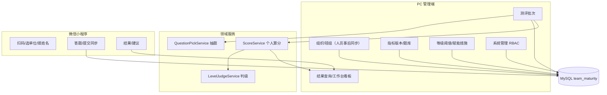
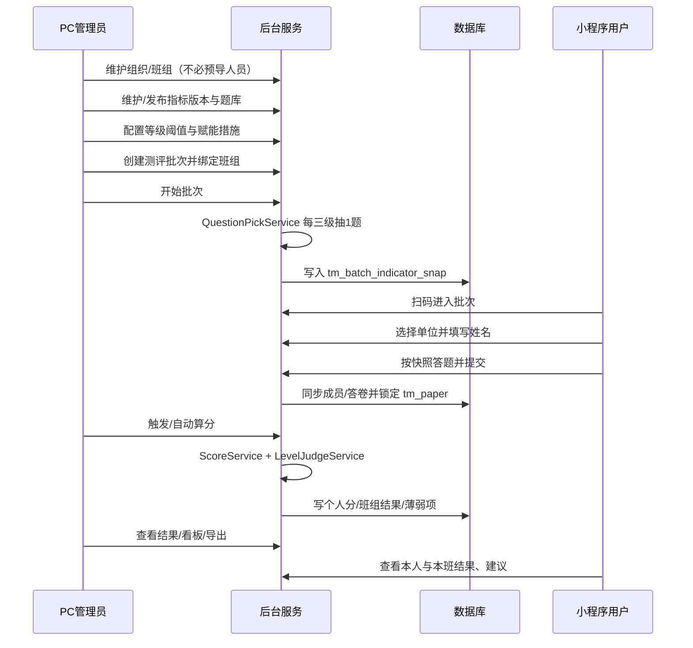
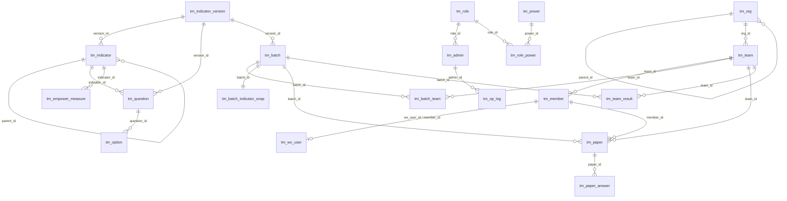

# 班组安全成熟度测评系统 — 技术方案 / 设计方案

| 项 | 内容 |
|----|------|
| 文档性质 | 总体技术方案与数据/流程设计 |
| 适用对象 | 客户技术沟通、内部研发对齐 |
| 配套文档 | 功能清单见 `客户需求对账清单.md`；需求原文见 `00-需求规格说明书.md` |
| 数据库 | `team_maturity`，表前缀 `tm_` |
| 技术栈 | PC：ThinkPHP 5 + Pear/Layui；小程序：微信端答题；MySQL 5.7+ |
| **看图方式** | 文中 ` ```mermaid ` 图在普通 Markdown/Word 里**不会自动画出来**。请用浏览器打开 [`技术方案设计方案-图表预览.html`](./技术方案设计方案-图表预览.html) 查看架构图 / 流程图 / **ER 图**。 |

---

## 1. 建设目标与定位

### 1.1 业务目标

以班组四级成熟度模型（被动型 → 依赖型 → 自立型 → 本质安全型）为标尺，实现：

1. **线上测评**：按标准题库作答，统一计分口径  
2. **分级画像**：按总分自动判级并展示阶段特征  
3. **精准赋能**：按薄弱指标推送建设措施  
4. **分析看板**：分布、趋势、排行，支撑管理决策  

### 1.2 端侧分工（PC First）

| 端 | 职责 | 不做 |
|----|------|------|
| **PC 管理端** | 组织人员、题库与阈值、赋能措施、发起批次、算分判级、结果与看板、权限 | 现场扫码答题（可用模拟做题联调） |
| **微信小程序** | 扫码进批次、选择单位、填写姓名、答题提交（事后同步人员/答卷）、看本人/本班结果与建议 | 组织配置、题库维护、批次管理、看板；**不要求事先导入人员/手机号预绑** |

---

## 2. 总体架构



### 2.1 逻辑分层

| 层 | 说明 |
|----|------|
| 展示层 | Pear 管理后台页面；小程序页面 |
| 应用层 | ThinkPHP Controller（`Tm*` / `TmMini*`） |
| 领域服务 | 抽题、算分、判级、导入、日志 |
| 数据层 | MySQL `tm_*` 表；Session（PC 登录 / 模拟试卷） |

### 2.2 功能模块关联总图

```mermaid
flowchart LR
  Org[组织档案] --> Team[班组]
  Team --> Member[成员(事后同步)]
  Member --> Paper[个人答卷]
  Paper -.-> Member
  Ver[指标版本] --> Ind[指标树]
  Ind --> Q[题目/选项]
  Ind --> Measure[赋能措施]
  Ver --> Batch[测评批次]
  Team --> Batch
  Batch --> Snap[开测快照]
  Snap --> Paper
  Paper --> Answer[答题明细]
  Paper --> Score[个人分]
  Score --> TeamResult[班组结果]
  Level[等级阈值] --> TeamResult
  Measure --> TeamResult
  TeamResult --> Dash[工作台/看板]
```

**关联解读（给客户对齐用）：**

- 开测前需有组织/班组与题库标准；**人员不必事先导入**。  
- 没有指标版本与题库，批次无法抽题。  
- 没有等级阈值，无法自动判级。  
- 没有赋能措施，结果只能出分、无法“精准帮扶”。  
- 小程序消费「批次 + 现场选单位/填姓名 + 快照试卷」；提交后同步人员与答卷；配置全在 PC。  

---

## 3. 端到端工作流程

### 3.1 主流程（正式测评）



### 3.2 分阶段流程说明

#### 阶段 A：主数据准备（PC）

1. 维护组织树（可变层级）  
2. 在组织节点下建班组  
3. **不必事先导入人员**（人员在扫码作答时填写，提交后同步）  
4. 确认参评范围（是否限制岗位，或扫码人均可答）  

#### 阶段 B：测评标准准备（PC）

1. 建立指标版本（一级权重建议合计 100）  
2. 维护一/二/三级指标与题目选项  
3. 维护四级阈值与阶段特征  
4. 按「指标 × 四等级」维护赋能措施（缺省可填「暂无」）  

#### 阶段 C：开测（PC → 固化试卷）

1. 创建批次，选择已发布版本、时间窗  
2. 绑定参评班组  
3. **开始批次**：对每个三级指标抽 1 题，写入批次快照  
4. 之后答题只读快照，与题库后续修改隔离  

#### 阶段 D：作答（小程序 / 或 PC 模拟）

1. 扫码进入批次 → 选择单位（组织/班组）→ 填写姓名  
2. 生成/打开个人答卷 `tm_paper`（提交时同步/落库成员）  
3. 逐题选择选项，写入 `tm_paper_answer`  
4. 提交后答卷锁定，并同步人员与答卷数据  

#### 阶段 E：算分判级与赋能

1. **个人分** = Σ（快照中该题三级权重 × 所选选项 score_ratio）  
2. **班组分** = 该班组已提交个人分的平均值（未提交不计入）  
3. **判级** = 班组分落入 `tm_level_threshold` 区间  
4. **薄弱指标** = 未拿满分的题目/指标，按失分排序  
5. **措施推送** = 按指标（及可选等级）取 `tm_empower_measure`  

#### 阶段 F：分析应用（PC）

1. 结果查询：班组汇总、个人明细、建议  
2. 工作台 / 看板：分布、趋势、排行  
3. 导出报表  

### 3.3 模拟做题流程（联调/演示，不落批次）

1. PC 选择指标版本 → 即时抽题入 Session  
2. 管理员作答 → 交卷  
3. 同口径个人算分 + 判级 + 薄弱措施  
4. **不写** `tm_batch` / `tm_paper`，不影响正式数据  

---

## 4. 功能模块设计与关联

| 模块 | 输入依赖 | 产出/服务对象 | 关键关联 |
|------|----------|----------------|----------|
| 组织档案 | — | 班组挂载点 | 组织 → 班组 |
| 班组管理 | 组织 | 批次绑定对象、成员容器 | 班组 → 成员；批次 ↔ 班组 |
| 成员管理 | 班组 | 事后归集/补全 | 扫码填姓名 → 提交后同步成员/答卷 |
| 指标版本/题库 | — | 批次抽题来源 | 版本 → 指标 → 题目 → 选项 |
| 等级阈值 | — | 判级规则 | 阈值 ← 班组结果.level_code |
| 赋能措施 | 指标、等级 | 结果页建议 | 措施.indicator_id → 三级指标 |
| 测评批次 | 版本、班组 | 快照、答卷、结果 | 批次是测评事务聚合根 |
| 模拟做题 | 版本、阈值、措施 | 演示结果 | 复用抽题/算分/判级服务 |
| 结果/看板 | 班组结果 | 管理决策 | 读 `tm_team_result` 等 |
| 系统管理 | — | 权限与审计 | 角色 → 菜单；操作写日志 |

---

## 5. 数据模型设计

### 5.1 主题域划分

| 域 | 表 | 说明 |
|----|-----|------|
| 权限 | `tm_admin` `tm_role` `tm_power` `tm_role_power` | PC 登录与菜单授权 |
| 组织人员 | `tm_org` `tm_team` `tm_member` `tm_wx_user` | 档案与小程序身份 |
| 标准题库 | `tm_indicator_version` `tm_indicator` `tm_question` `tm_option` | 版本化指标体系 |
| 测评运行 | `tm_batch` `tm_batch_team` `tm_batch_indicator_snap` `tm_paper` `tm_paper_answer` | 批次与答卷 |
| 结果赋能 | `tm_team_result` `tm_level_threshold` `tm_empower_measure` | 判级与措施 |
| 运维 | `tm_import_job` `tm_op_log` | 导入与操作审计 |

### 5.2 表关系（ER 逻辑图）



### 5.3 关键外键语义（逻辑关联，应用层保证）

| 从表 | 关联字段 | 主表 | 说明 |
|------|----------|------|------|
| tm_team | org_id | tm_org.id | 班组挂任意组织节点 |
| tm_member | team_id | tm_team.id | 成员属班组 |
| tm_member | wx_user_id | tm_wx_user.id | 可选，绑定后回写 |
| tm_wx_user | member_id | tm_member.id | 小程序用户绑档案 |
| tm_indicator | version_id | tm_indicator_version.id | 指标属版本 |
| tm_indicator | parent_id | tm_indicator.id | 指标树 |
| tm_question | indicator_id | tm_indicator.id | 题挂三级指标（可 1:N） |
| tm_option | question_id | tm_question.id | 选项 |
| tm_empower_measure | indicator_id | tm_indicator.id | 措施挂三级；可空=等级通用 |
| tm_empower_measure | level_code | tm_level_threshold.level_code | 逻辑对应等级 |
| tm_batch | version_id | tm_indicator_version.id | 批次用哪套标准 |
| tm_batch_team | batch_id / team_id | batch / team | 参评班组 |
| tm_batch_indicator_snap | batch_id | tm_batch.id | 一整份开测题集快照 |
| tm_paper | batch_id / member_id / team_id | — | 一人一批次一卷 |
| tm_paper_answer | paper_id | tm_paper.id | 答题明细 |
| tm_team_result | batch_id / team_id | — | 一班组一批次一条结果 |
| tm_admin | role_id | tm_role.id | 管理员角色 |
| tm_role_power | role_id / power_id | role / power | 角色菜单 |

### 5.4 核心表职责摘要

**组织人员**

- `tm_org`：树形组织，`parent_id`，层数不固定  
- `tm_team`：班组，`org_id` 指向组织  
- `tm_member`：成员（可事后由扫码作答写入）；`mobile` 可选；`role_code` 可选  
- `tm_wx_user`：小程序 OpenID；可与成员弱关联，**不强制手机号预绑档案**  

**题库**

- `tm_indicator_version`：版本 + `question_pick_mode`（first/random/sequential）  
- `tm_indicator`：`level_no` 1/2/3，`weight` 用于算分（三级权重进入公式）  
- `tm_question` / `tm_option`：题与选项，`score_ratio` 为得分比例  

**测评运行**

- `tm_batch`：批次状态、时间、版本  
- `tm_batch_team`：批次-班组多对多  
- `tm_batch_indicator_snap`：开测时固化「每三级一题」的 JSON 快照  
- `tm_paper`：个人答卷状态、个人总分  
- `tm_paper_answer`：题-选项明细及小题得分  

**结果赋能**

- `tm_level_threshold`：四档区间与特征  
- `tm_team_result`：班组总分、等级、薄弱指标 JSON  
- `tm_empower_measure`：建设措施（建议每指标四等级各一条）  

### 5.5 算分与判级数据流

```text
快照题目.weight  ×  所选选项.score_ratio  →  小题得分
Σ 小题得分                               →  个人总分 (tm_paper)
AVG(已提交个人总分)                      →  班组总分 (tm_team_result)
班组总分 ∩ tm_level_threshold            →  level_code / 等级名称
薄弱指标 → tm_empower_measure            →  赋能建议文案
```

**建议判级口径（可配置）：**

| 等级 code | 名称 | 区间约定 |
|-----------|------|----------|
| passive | 被动型 | [0, 70) |
| dependent | 依赖型 | [70, 80) |
| independent | 自立型 | [80, 90] |
| essential | 本质安全型 | (90, 100] |

---

## 6. 关键业务规则

1. **不必事先导入人员**；答卷通过「选单位 + 姓名」归属班组；若启用手机号字段，建议唯一。  
2. **停用班组**不可加入新批次；进行中批次已绑定的可答完。  
3. **已发布指标版本**不宜直接改题；变更应复制新版本。  
4. **发布校验（建议）：** 一级权重合计≈100；每个三级至少 1 题；每题至少 2 选项。  
5. **开测抽题：** 每三级指标只抽 1 道进入快照；答题只认快照。  
6. **提交锁定：** `tm_paper.status=已提交` 后禁止改答。  
7. **班组均分：** 仅统计已提交；0 人提交则无班组有效结果或标记无数据。  
8. **组织层级：** 不强制 2/3 层；班组可挂任意组织节点。  

---

## 7. 接口与页面域划分（逻辑）

| 域 | 典型入口 | 说明 |
|----|----------|------|
| 工作台 | `/Index/welcome` | KPI + 等级分布 + 明细 |
| 组织档案 | `/TmOrg` `/TmTeam` `/TmMember` | CRUD + Excel 导入 |
| 评价指标 | `/TmIndicatorVersion` `/TmIndicator` `/TmLevel` | 版本、题库、阈值与措施 |
| 测评管理 | `/TmBatch` `/TmResult` `/TmMockExam` | 批次、结果、模拟做题 |
| 统计分析 | `/TmDashboard/*` | 分布/趋势/排行 |
| 系统管理 | `/TmAdmin` `/TmRole` `/TmImport` `/TmLog` | 账号权限与审计 |
| 小程序 API | `/TmMini*` `/TmMinilogin*` | 登录绑定答题提交结果 |

详细 API 清单见 `docs/02-admin-api.md`、`docs/03-mini-api.md`。

---

## 8. 非功能设计要点

| 类别 | 方案要点 |
|------|----------|
| 安全 | PC Session 鉴权；密码 bcrypt；小程序 JWT；按角色菜单授权 |
| 一致性 | 开测快照隔离题库变更；答卷提交后不可改 |
| 审计 | 关键操作写 `tm_op_log`；导入写 `tm_import_job` |
| 性能 | 看板可按批次缓存；列表分页；快照按批次一份 |
| 扩展 | 题池 1:N + 抽题策略；组织可变深；措施按等级扩展 |
| 部署 | 独立库 `team_maturity`；与旧系统业务隔离 |

---

## 9. 与客户对齐时建议强调的设计点

1. **PC 配置、小程序答题** 的职责边界  
2. **批次快照机制**：开测后改题不影响进行中测评  
3. **个人分 → 班组均分 → 判级 → 措施** 的闭环  
4. **一指标四等级措施** 如何支撑精准赋能  
5. **参评范围（岗位限制与否）**、**分数边界** 需业务拍板；人员入口已定为扫码选单位填姓名  
6. **模拟做题** 仅用于演示联调，不替代正式批次数据  

---

## 10. 附录：表清单一览

| 表名 | 中文名 |
|------|--------|
| tm_admin / tm_role / tm_power / tm_role_power | 管理员 / 角色 / 菜单 / 角色权限 |
| tm_org / tm_team / tm_member / tm_wx_user | 组织 / 班组 / 成员 / 微信用户 |
| tm_indicator_version / tm_indicator / tm_question / tm_option | 版本 / 指标 / 题目 / 选项 |
| tm_batch / tm_batch_team / tm_batch_indicator_snap | 批次 / 批次班组 / 开测快照 |
| tm_paper / tm_paper_answer | 个人答卷 / 答题明细 |
| tm_team_result | 班组批次结果 |
| tm_level_threshold / tm_empower_measure | 等级阈值 / 赋能措施 |
| tm_import_job / tm_op_log | 导入任务 / 操作日志 |

---

*本文描述系统设计方案，用于需求与技术对齐；具体字段以 `sql/01-schema.sql`、`sql/03-pc-admin.sql` 为准。*
